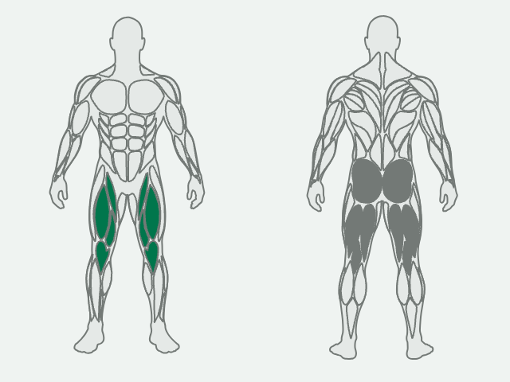
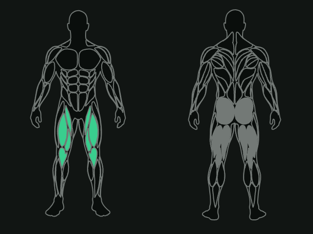
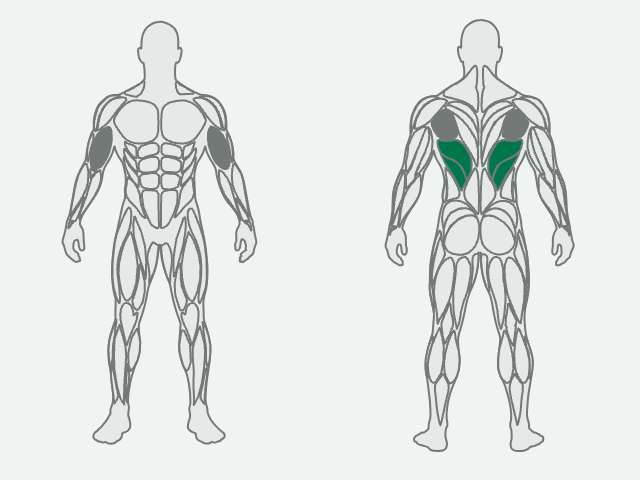
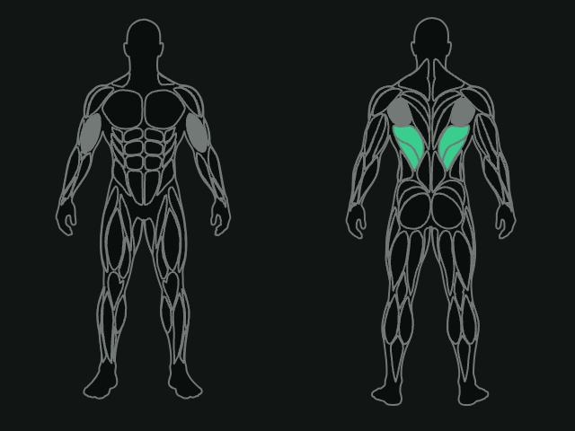

# Fase 4A: spike do mapa corporal (Task 1)

- **Data:** 2026-10-29
- **Branch do spike:** `spike/phase4a-bodymap`, saída da `main` em `739a800`, nunca mesclada nem enviada. Commit `7d5e2df` (conversor rascunho, `SpikeBodyMap`, as duas formas, `BodyMapSpikeTest` e os resultados brutos em `spike-results/phase4a-bodymap/`)
- **Spec:** [fase 4, D6](../specs/2026-10-29-phase4-library-routines-design.md) · **Plano:** [4A, Task 1](../plans/2026-10-29-phase4a-library.md) · **Pesquisa:** [P5](2026-10-29-figuras-mapa-muscular.md)
- **Evidências:** [2026-10-29-phase4a-spike-mapa/](2026-10-29-phase4a-spike-mapa/) (as capturas citadas, o XML do teste e as linhas de contraste). As 41 capturas e o logcat completo ficam na branch do spike.

## Resumo

- **Fonte: MuscleMap, mantida.** `Jsplice/MuscleMap`, commit **`170cfacda79376dd59ac0cf2f7dfab8ff9f4443a`** (2026-09-15, "Merge pull request #38 from Jsplice/changeset-release/main"; `@musclemap/assets` 1.1.0), MIT. O plano B (`vulovix/body-muscles`) não foi necessário: nenhum dos três gatilhos da regra disparou.
- **Forma A:** strings de path por região e vista, lidas com `PathParser().parsePathString(d).toPath()` uma vez por processo e guardadas em cache. Custa **+64,0 KiB** no APK debug (+65.536 bytes), contra **+96,0 KiB** da forma B, e as duas desenham os mesmos pixels nas 24 capturas comparadas (0 pixel diferente).
- **Precisão:** 1 casa decimal no `viewBox` original de 1024 × 1536. A fonte já vem com 1 casa, então o arredondamento não mudou nenhum número. Não foi preciso passar para inteiros.
- **Pescoço:** a fonte não tem id de pescoço, então `NECK` acende os caminhos do trapézio (frente: as duas peças na base do pescoço; costas: o trapézio superior e o médio).
- **Cores:** contorno `borderStrong`, neutro `bgInset`, principal `accentSolid`, **secundário `borderStrong`**. É o único candidato com pelo menos 3:1 contra o neutro nos dois temas sem token novo.
- **Ponto aberto para a Task 6:** com neutro `bgInset` e principal `accentSolid`, **no tema claro nenhuma cor de secundário fica a 3:1 do neutro e do principal ao mesmo tempo**, porque a conta não fecha (detalhe abaixo). O teste `bodyMapPrimaryAndSecondaryStandOut` da Task 6, do jeito que está escrito ("principal × secundário ≥ 3:1"), não passa com nenhum candidato.

## Fonte

Clone raso numa pasta nova e vazia do scratchpad. Nada da fonte foi executado: o conversor lê os `.ts` como texto e roda com `python3 -I` de fora da pasta clonada.

| Arquivo | Bytes | SHA-256 |
|---|---:|---|
| `packages/assets/src/male-front.ts` | 56.819 | `58cc6b7cc7493ddf6e6f60f94e83323abd4166d594521e33e75bb44173106a01` |
| `packages/assets/src/male-back.ts` | 75.388 | `767c0adb90d6cb4dfa36e11ea5b98414ef54a1fd6dc922dd3e19502f4d1da0bc` |
| `LICENSE` | | `f7347b3759d6cb8c4a27d229a446aaed2af50e23012755615b98eb874af38a3d` |

- **Licença:** MIT, "Copyright (c) 2026 Jsplice / MuscleMap contributors". Um adendo diz que a licença cobre também "the SVG muscle path data in `packages/assets` (original traced vector work)".
- **Procedência (`ASSET_PROVENANCE.md`):** os paths são "original vector work authored for this project", traçados à mão no Inkscape. As fotos de fundo foram geradas com ferramentas da OpenAI e serviram de base para o traçado. Elas não entram no Mooscles: só os paths entram.
- **Formato:** cada `BodyDiagram` tem `viewBox "0 0 1024 1536"`, `centerX 512`, um único contorno (`BODY`) e os músculos. Todos os caminhos masculinos vêm com `side: "CENTER"` e os dois lados já desenhados, com ids `<MÚSCULO>_LEFT`/`_RIGHT`, então não há espelhamento na hora de desenhar. Os comandos são só `M`, `L`, `C` e `Z` absolutos, com 1 casa decimal e sem números negativos.
- **Datas:** o HEAD da branch padrão é de 2026-09-15. O relatório P5 citava um push em 23/10/2026, que deve ter sido em outra branch. O commit anotado é o que foi clonado.

## Agrupamento final

Os dois lados de cada região entram juntos. Dois caminhos de frente do grupo `QUADS` vêm sem id e entram pelo grupo, como quadríceps. Os grupos `BACK_UPPER` e `HIP_FLEXORS` da fonte não têm caminho.

| Região (`BodyRegion`/`MuscleRegion`) | Ids do MuscleMap | Frente | Costas |
|---|---|---:|---:|
| `ABDOMINALS` (abdominais) | `CORE_*`, `OBLIQUE_*` | 4 | 2 (oblíquos) |
| `ABDUCTORS` (abdutores) | `ABDUCTOR_*` | 2 | 2 |
| `ADDUCTORS` (adutores) | `ADDUCTOR_*` | 2 | 2 |
| `BICEPS` (bíceps) | `BICEPS_*` | 2 | 0 |
| `CALVES` (panturrilhas) | `CALVES_*` | 2 | 2 |
| `CHEST` (peito) | `CHEST_*` | 2 | 0 |
| `FOREARMS` (antebraços) | `FOREARM_*` | 2 | 2 |
| `GLUTES` (glúteos) | `GLUTEUS_*` | 0 | 2 |
| `HAMSTRINGS` (posteriores da coxa) | `HAMSTRINGS_*` | 0 | 2 |
| `LATS` (dorsais) | `LATISSIMUS_*` | 0 | 2 |
| `LOWER_BACK` (lombar) | `LOWER_BACK_*` | 0 | 2 |
| `MIDDLE_BACK` (meio das costas) | `RHOMBOID_*` | 0 | 2 |
| `NECK` (pescoço) | os caminhos de `TRAPS` | 2 | 4 |
| `QUADRICEPS` (quadríceps) | `QUADRICEPS_*` e 2 sem id do grupo `QUADS` | 4 | 0 |
| `SHOULDERS` (ombros) | `SHOULDER_FRONT_*`, `SHOULDER_SIDE_*`, `SHOULDER_REAR_*` | 4 | 4 |
| `TRAPS` (trapézio) | `TRAPEZIUS_*` | 2 | 4 |
| `TRICEPS` (tríceps) | `TRICEPS_*` | 2 | 2 |
| silhueta neutra | `BODY` | 1 | 1 |

Toda região tem caminho em pelo menos uma vista. No total são 58 caminhos de músculo e 2 contornos.

**Duas leituras da fonte que a Task 2 deve conhecer** (não são ambiguidade no desenho, cada região acende uma área separada):

- O `RHOMBOID` do MuscleMap fica **sobre a escápula** (a área do infraespinal e do redondo), não entre as escápulas. O centro das costas é trapézio médio e inferior ([`region-middle_back.png`](2026-10-29-phase4a-spike-mapa/region-middle_back.png), [`region-traps.png`](2026-10-29-phase4a-spike-mapa/region-traps.png)). Numa remada com o meio das costas como secundário, a faixa entre as escápulas fica neutra, a menos que a anatomia também liste `TRAPS`.
- O `ABDUCTOR` de frente é a **faixa lateral da coxa** (tensor da fáscia lata). No agachamento, com quadríceps como principal, essa faixa fica neutra ([`region-abductors.png`](2026-10-29-phase4a-spike-mapa/region-abductors.png)).

## Estilo "giz" e capturas

`SpikeBodyMap` desenha as duas vistas lado a lado num único `Spacer` com `drawWithCache`: a silhueta e todas as regiões com preenchimento `bgInset` e contorno `borderStrong` de `MTheme.sizes.border` (1 dp), o principal em `accentSolid` e o secundário no candidato testado. A geometria é a da fonte, só escalada para a altura do componente. O componente usa só tokens que já existem.

`BodyMapSpikeTest` (só emulador, `emulator-5556`, `Mooscles_Pixel8_API35`, Android 15) desenha o agachamento (principal quadríceps, secundários glúteos e posteriores) e a remada (principal dorsais, secundários meio das costas e bíceps), nos dois temas, a 1,0 e 2,0 de densidade, com 320 dp de largura, para três candidatos de secundário: `accentSubtle`, `accentText` com alfa 0,72 e `borderStrong`. Isso dá 24 capturas da forma A, cada uma comparada pixel a pixel com a forma B: **0 pixel diferente nas 24**. Resultado: `tests="6" failures="0"` no `connectedAndroidDeviceTest` filtrado pela classe ([XML](2026-10-29-phase4a-spike-mapa/android-connectedAndroidDeviceTest.xml)).

| | Claro | Escuro |
|---|---|---|
| Agachamento, 2,0 |  |  |
| Remada, 2,0 |  |  |

A 1,0 ([`row-light-d1-border.png`](2026-10-29-phase4a-spike-mapa/row-light-d1-border.png), 320 × 240 px) as regiões continuam legíveis, e o contorno de 1 px ainda separa os músculos. Os candidatos descartados: [`squat-light-d2-subtle.png`](2026-10-29-phase4a-spike-mapa/squat-light-d2-subtle.png) (o secundário quase some no claro) e [`row-dark-d2-text_alpha.png`](2026-10-29-phase4a-spike-mapa/row-dark-d2-text_alpha.png) (verde perto do principal, e o alfa deixa aparecer os traços de baixo).

Nenhuma região ficou ambígua nas capturas: cada uma das 17, acesa sozinha, ocupa uma área própria (as 17 capturas `region-*.png` estão na branch do spike).

## Contraste

Linhas `SPIKE contrast` do teste ([contrast.txt](2026-10-29-phase4a-spike-mapa/contrast.txt)), pela `Contrast.ratio` do design system. O secundário com alfa foi composto sobre o `bgInset`, que é a cor que aparece na tela.

| Par | Claro | Escuro |
|---|---:|---:|
| principal (`accentSolid`) × neutro (`bgInset`) | 4,63 | 9,61 |
| principal × `bgBase` | 5,07 | 9,11 |
| principal × `bgSurface` | 5,53 | 8,33 |
| `accentSubtle` × neutro | **1,01** | **1,44** |
| `accentSubtle` × `bgBase` | 1,07 | 1,37 |
| `accentText` a 0,72 × neutro | 3,17 | 6,67 |
| `accentText` a 0,72 × `bgBase` | 3,47 | 6,33 |
| `accentText` a 0,72 × `bgSurface` | 3,79 | 5,79 |
| `accentText` a 0,72 × principal | 1,45 | 1,43 |
| **`borderStrong` × neutro** | **3,62** | **4,37** |
| **`borderStrong` × `bgBase`** | **3,97** | **4,14** |
| **`borderStrong` × `bgSurface`** | **4,33** | **3,79** |
| `borderStrong` × principal | 1,27 | 2,19 |

**Escolha: secundário em `borderStrong`.** O `accentSubtle` reprova contra o neutro nos dois temas. O `accentText` com alfa passa, mas com folga de só 0,17 no claro, precisaria de um token de alfa novo e, por ser translúcido, deixa ver os traços internos do contorno. O `borderStrong` passa nos dois temas, contra o neutro e contra os dois fundos, é opaco e já existe. Como é a cor do contorno, os traços internos de uma região secundária somem e ela vira uma mancha cinza só. A borda que conta, secundário contra neutro, fica com 3,6:1 ou mais.

**Por que nenhum candidato separa principal e secundário a 3:1:** no claro, o neutro tem luminância de cerca de 0,80 e o principal de cerca de 0,13. Para ficar a 3:1 do neutro, o secundário precisa de luminância de no máximo 0,23. Para ficar a 3:1 do principal, precisa de pelo menos 0,50. As duas condições não se cumprem juntas. O melhor equilíbrio possível dá cerca de 2,15:1 para os dois lados no claro. No escuro dá 3,1:1, que passaria por pouco, mas o claro não fecha. Com esse neutro e esse principal, a distinção entre principal e secundário fica a cargo da legenda (amostra e texto), do texto equivalente sempre visível (D6) e da diferença de matiz (verde contra cinza). A Task 6 precisa tirar "principal × secundário" do `bodyMapPrimaryAndSecondaryStandOut` ou trocar o neutro ou o principal. Essa decisão é do controlador.

## Tamanho no APK

`perl -e 'alarm shift; exec @ARGV' 900 ./gradlew :app:clean :app:assembleDebug` e `stat -f%z app/build/outputs/apk/debug/app-debug.apk`. A base é a `main` `739a800`, sem o pacote `spike`. Cada forma foi medida com o renderizador e só os seus dois arquivos.

| Build | APK (bytes) | Δ APK | Δ entradas comprimidas | Δ `classes10.dex` (cru) |
|---|---:|---:|---:|---:|
| base | 23.652.343 | | | |
| **A** (strings + `PathParser`) | 23.717.879 | **+65.536 (64,0 KiB)** | +66.726 | +149.804 |
| B (funções `PathBuilder`) | 23.750.647 | +98.304 (96,0 KiB) | +96.884 | +222.320 |

O tamanho do arquivo APK muda em múltiplos de 4 KiB (deve ser o alinhamento), então a soma das entradas comprimidas (`unzip -lv`) é a medida mais fina. As duas medidas põem as duas formas abaixo do alvo de 120 KiB, e a A é a mais barata. Os dois números incluem o renderizador (`SpikeBodyMapKt`, cerca de 18,7 KB de bytecode).

**Limites:** nenhum foi ultrapassado. Na forma A, a maior constante de string é o contorno das costas, com 17,7 KB (o limite é 65.535 bytes). Na forma B, o maior método é `backOutline0`, com 11.262 bytes de bytecode JVM (limite de 64 KB), e a classe tem 8.461 entradas no constant pool. Os fontes gerados têm 130 KB (A) e 222 KB (B).

## Tempo de montagem (informativo)

O custo de ler os caminhos uma vez por processo, no emulador e com o APK de teste debuggable:

| | Forma A | Forma B |
|---|---:|---:|
| primeira montagem num processo novo (3 rodadas, cada uma com `am instrument` próprio) | 119 / 159 / 126 ms | 41 / 45 / 54 ms |
| mediana já aquecida (6 rodadas alternadas) | 9,5 a 14 ms | 5,0 a 8,3 ms |

A forma A custa cerca de 80 a 110 ms a mais na primeira vez, uma vez por processo. A regra de decisão é o tamanho, e por ela fica a A. A Task 6 deve montar a geometria fora da thread principal (por exemplo `Dispatchers.Default` na primeira composição, ou um aquecimento quando a biblioteca abre), para o primeiro detalhe não travar. O APK distribuído é o debug, então o aparelho também roda sem R8 e com o código mais interpretado.

## Decisão (para a Task 6)

| Item | Valor |
|---|---|
| Fonte | `Jsplice/MuscleMap`, `@musclemap/assets` 1.1.0, MIT |
| Commit de origem | `170cfacda79376dd59ac0cf2f7dfab8ff9f4443a` |
| Arquivos | `packages/assets/src/male-front.ts`, `male-back.ts` (só o corpo masculino) |
| Agrupamento | a tabela acima |
| Forma | **A**: strings de path por região e vista, `PathParser().parsePathString(d).toPath()` com cache, montadas fora da thread principal |
| Precisão | 1 casa decimal, `viewBox` 1024 × 1536 (o da fonte, sem reescala) |
| Pescoço | os caminhos do trapézio (a fonte não tem id de pescoço) |
| Cores | contorno `borderStrong`, neutro `bgInset`, principal `accentSolid`, secundário `borderStrong` |
| Token novo | nenhum |

## O que não foi provado

- **O mapa num iPhone e no simulador iOS:** o spike rodou só no emulador Android (sem Xcode nesta máquina). O `uiTest` compila para o iOS com um `spikeSavePng` que não grava nada, mas nem isso foi compilado aqui. O `PathParser` e o desenho do Skiko ficam para o CI da Task 6.
- **Aparelho físico:** nenhum. O tempo da primeira montagem num aparelho real pode ser outro.
- **A forma com inteiros** (`viewBox` reescalado para 512 × 768): não foi medida, porque a forma A já ficou abaixo de 120 KiB.
- **A leitura humana do mapa**, além da minha inspeção das capturas: a crítica de tela da fase decide.
- **O corpo feminino** da fonte não foi avaliado (a spec pede um mapa só).
