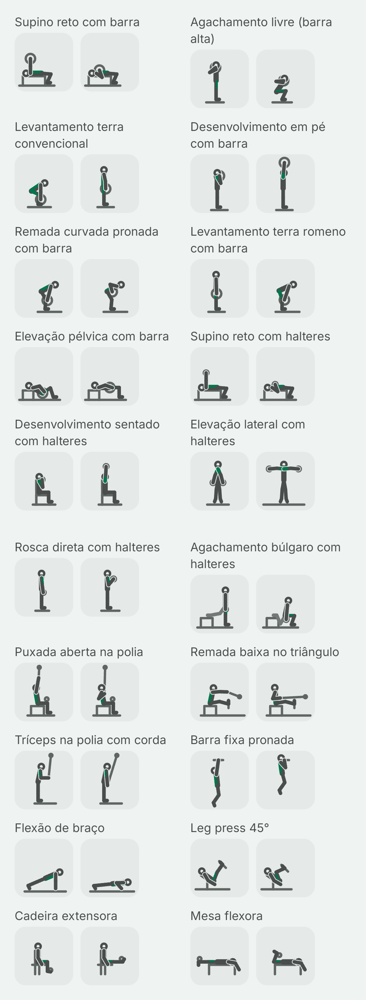
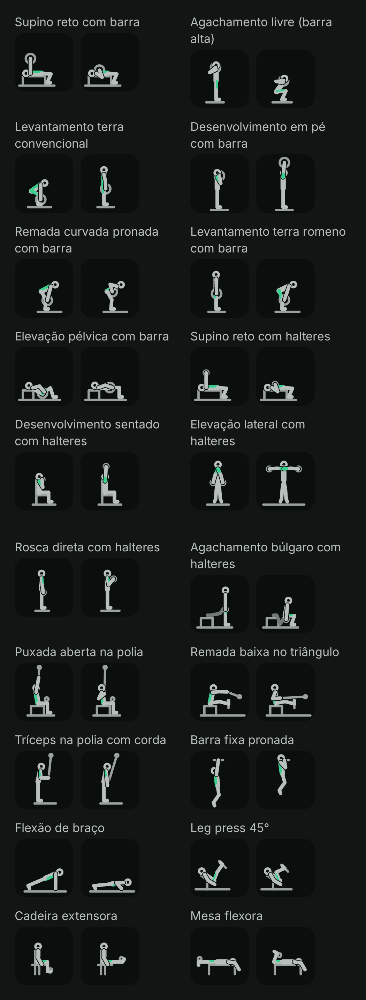

# Fase 4A: folha do piloto das figuras (portão G1)

Data: 2026-10-30. Plano: [fase 4A, Task 9](../plans/2026-10-29-phase4a-library.md#task-9-folha-do-piloto-para-o-portão-g1). Spec: [D3, D4 e D5](../specs/2026-10-29-phase4-library-routines-design.md#mídia-do-exercício).

Esta folha serve para você decidir uma coisa: se as figuras desenhadas por código ficam no app. A pergunta está no fim.

## O que você está vendo

São os 20 exercícios do piloto, cada um com dois quadros:

- **A** (à esquerda): onde a repetição começa.
- **B** (à direita): onde ela vira. É o quadro que aparece parado nas listas.

No detalhe do exercício, os dois quadros se alternam sozinhos, a cada 0,9 s. Com "reduzir movimento" ligado, a figura fica parada no B, e um toque troca o quadro.

As figuras são desenhadas pelo app, sem imagem pronta, com as cores do tema. O corpo fica em cinza, o equipamento num cinza mais claro, o lado de lá do corpo mais apagado e o músculo principal em verde.

Há quatro imagens, todas capturadas no emulador (Pixel 8, Android 15) pelo próprio renderizador do app:

| | Tema claro | Tema escuro |
| --- | --- | --- |
| **64 dp** (o tamanho da miniatura na lista) | [pilot-light-64.png](2026-10-29-phase4a-verificacao/pilot-light-64.png) | [pilot-dark-64.png](2026-10-29-phase4a-verificacao/pilot-dark-64.png) |
| **360 dp** (o tamanho no detalhe, num celular de 412 dp) | [pilot-light-detail.png](2026-10-29-phase4a-verificacao/pilot-light-detail.png) | [pilot-dark-detail.png](2026-10-29-phase4a-verificacao/pilot-dark-detail.png) |

As duas folhas do detalhe são compridas (40 quadros cada). Abra pelos links da tabela.

Como as imagens foram feitas:

- As miniaturas usam a densidade do emulador (2,625×), pixel por pixel como no celular.
- A folha do detalhe foi desenhada com densidade 1,35×, para caberem dois quadros de 360 dp lado a lado. O desenho é vetorial, então muda só a resolução, não a proporção.
- Os PNGs estão sem compressão de paleta (não há `pngquant` nesta máquina): 224 KB e 227 KB as de 64 dp, 418 KB e 427 KB as do detalhe.

## Os 20 exercícios

| # | Nome no app | `stableId` |
| --- | --- | --- |
| 1 | Supino reto com barra | `barbell_bench_flat` |
| 2 | Agachamento livre (barra alta) | `barbell_back_squat_high_bar` |
| 3 | Levantamento terra convencional | `barbell_deadlift_conventional` |
| 4 | Desenvolvimento em pé com barra | `barbell_overhead_press` |
| 5 | Remada curvada pronada com barra | `barbell_row_overhand` |
| 6 | Levantamento terra romeno com barra | `barbell_deadlift_romanian` |
| 7 | Elevação pélvica com barra | `barbell_hip_thrust` |
| 8 | Supino reto com halteres | `dumbbell_bench_flat` |
| 9 | Desenvolvimento sentado com halteres | `dumbbell_press_seated` |
| 10 | Elevação lateral com halteres | `dumbbell_raise_lateral` |
| 11 | Rosca direta com halteres | `dumbbell_curl_standing` |
| 12 | Agachamento búlgaro com halteres | `dumbbell_squat_bulgarian` |
| 13 | Puxada aberta na polia | `cable_lat_pulldown_wide` |
| 14 | Remada baixa no triângulo | `cable_row_close_neutral` |
| 15 | Tríceps na polia com corda | `cable_triceps_pushdown_rope` |
| 16 | Barra fixa pronada | `bodyweight_pull_up` |
| 17 | Flexão de braço | `bodyweight_push_up` |
| 18 | Leg press 45° | `plate_leg_press_45` |
| 19 | Cadeira extensora | `selectorized_leg_extension` |
| 20 | Mesa flexora | `selectorized_leg_curl_lying` |

## A crítica e o que mudou

Fiz a crítica de tela (`critique-screen`) nas quatro folhas, com três perguntas:

- dá para entender o movimento a 64 dp?
- dá para ver o destaque do músculo?
- o quadro A é diferente do B?

### Achados altos: corrigidos antes desta folha

A primeira captura tinha três problemas de leitura que valiam para vários exercícios. Todos foram corrigidos e capturados de novo.

1. **Quem está em pé parecia um poste com um anel**, a 64 dp: agachamento, terra, desenvolvimento, romeno, rosca e tríceps. O tronco tinha a mesma espessura dos braços e das pernas, e o braço junto do corpo sumia dentro dele.
   - Correção: o tronco agora é uma vez e meia mais grosso que os membros.
   - Além disso, o braço da frente ganhou um contorno vazado, uma fresta da cor do fundo. Ela separa o braço do tronco quando ele passa na frente.
2. **A cabeça se perdia atrás da anilha**, no agachamento, no desenvolvimento em pé e no sentado: o anel da cabeça e o anel da anilha se misturavam.
   - Correção: a cabeça também ganhou o contorno vazado e fica sempre na frente.
   - No agachamento, o cotovelo agora aponta para trás, como na execução real, e o braço não dobra mais por cima da cabeça.
3. **Poses que enganavam**, apontadas na revisão da Task 8:
   - Barra fixa: a barra era uma linha comprida atravessando o rosto. Agora é curta, e no fim do movimento o cotovelo aparece na frente do peito.
   - Leg press: o pé dobrava 45° contra a canela, mais do que o tornozelo dobra de verdade, e o banco flutuava. Agora a dobra do tornozelo fica perto de 20°, os joelhos chegam a uns 90° e o banco tem chão.
   - Elevação lateral: o início era uma cunha escura. Agora os braços e as pernas ficam um pouco abertos.

Essas mudanças estão nos commits `designsystem: heavier trunk and gaps for the head and arms in figures` e `screens: pilot pose fixes from the sheet critique`. O renderizador ganhou dois testes, e os dois valores novos estão fixados em teste.

### Achados médios: ficam como estão, com o motivo

- **O agachamento a 64 dp ainda é o mais carregado:** cabeça, anilha e braço no mesmo lugar. Numa vista de lado, a barra fica mesmo atrás do pescoço, e uma anilha de tamanho real cobre a cabeça. No detalhe a figura se lê bem; na lista, ela se reconhece pela forma do quadro B (agachado).
- **Desenvolvimento em pé e sentado, quadro A:** a mão e o peso ficam na frente do rosto. É a posição real (a barra apoiada na frente dos ombros), mas é o quadro mais confuso dos dois. A lista mostra o B (braço esticado para cima), que é claro.
- **Elevação pélvica:** os braços seguram a barra formando um "V" sobre o quadril, e a anilha cobre parte do destaque do glúteo no quadro A. No B (quadril em cima), o tronco e a coxa em linha leem bem.
- **Mesa flexora:** a cabeça, o braço e o rolo da máquina se juntam na ponta do banco. O movimento (a perna dobrando) se lê bem.

### Achados baixos

- **Rosca direta:** A e B diferem só pelo antebraço. Dá para ver a 64 dp, mas é a menor diferença da folha.
- **Terra (B) e romeno (A):** os dois são de pé com a barra nas coxas. É correto, porque é a mesma posição.
- **Tema escuro:** o lado de lá do corpo (a perna de trás do búlgaro) fica apagado, como deve. O contraste é de pelo menos 3:1, já testado, mas ele chama menos atenção que no tema claro.
- **Tríceps na polia:** a corda não aparece; o cabo vai direto à mão.
- **Cadeira extensora:** o braço desce na diagonal até a pegada do banco e cruza o tronco.
- **Deitado no banco:** com o tronco mais grosso, as costas encostam um pouco além da linha do banco, cerca de 1 dp a 64 dp.
- **Cor e tipo:** o verde do destaque se vê nos dois temas e nos dois tamanhos. Esta folha não é uma tela do app, então hierarquia, toque e texto não se aplicam aqui. Eles entram na crítica das telas da biblioteca (Task 23).

## O que lê bem, o que ainda está cru e o que um ilustrador faria melhor

**Lê bem:**

- A diferença entre A e B se vê em todos os 20, também a 64 dp.
- A família de cada movimento se reconhece pela silhueta: deitado no banco, sentado na máquina, de pé, pendurado, na polia.
- O verde do músculo aparece nos dois temas.
- O estilo é coerente: o mesmo corpo, as mesmas proporções e o mesmo traço em todos.
- Pesa quase nada no app (cerca de 160 bytes por pose) e funciona sem internet.

**Ainda está cru:**

- São bonecos de palito com corpo. Não há mãos, pés com forma, roupa nem volume de músculo.
- Onde muita coisa se sobrepõe numa vista de lado (barra nas costas, peso na frente do rosto), a figura fica carregada.
- O quadro único de cada fase não mostra a trajetória (não há seta nem rastro).

**O que um ilustrador contratado faria melhor:**

- Escolheria o ângulo de câmera de cada exercício (três quartos, de frente, de cima) em vez de um só lado.
- Desenharia a silhueta com volume, mãos e pés.
- Mostraria a trajetória com seta.
- Daria a cada equipamento a sua forma reconhecível (a corda do tríceps, o banco do leg press).

O custo seria encomendar e revisar 287 exercícios, com a etapa de download (4M) se o pacote não couber no app.

## O que não foi provado

- **As figuras num iPhone.** O código compila para iOS, mas nunca foi visto rodando num iPhone nem no simulador. Os testes de iOS rodam só no CI.
- **A leitura por quem treina.** Ninguém além do agente que desenhou e revisou olhou estas figuras. O teste de verdade é você, ou alguém da academia, reconhecer o exercício pela miniatura sem ler o nome.
- **Celular físico.** Só o emulador.
- **Referências.** Nenhuma imagem de referência foi aberta ou decalcada. As poses vêm de conhecimento geral de execução e das dicas do próprio app. Não há nenhum asset gerado por IA.

## Pergunta do G1

**Aprova a folha do piloto?** Com aprovação, os lotes seguem por equipamento até os 287; sem aprovação, as figuras saem do produto e fica o ícone do equipamento.
