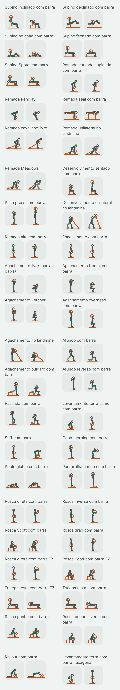
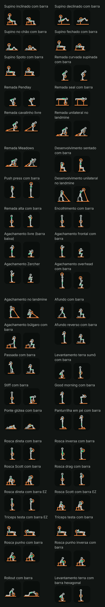

# Fase 4: figuras do lote da barra (Task L)

Data: 2026-10-31. Plano: [fase 4A, Task L](../plans/2026-10-29-phase4a-library.md#task-l-condicional-só-com-o-g1-aprovado-um-lote-de-figuras). Spec: [D3, D4, D5 e D21](../specs/2026-10-29-phase4-library-routines-design.md#mídia-do-exercício). Piloto aprovado no G1, com o equipamento em cobre: [folha do piloto](2026-10-30-phase4a-folha-piloto.md).

Este é o primeiro lote depois do piloto. Ele desenha todos os exercícios de barra do catálogo que ainda não tinham figura: os de barra reta, os de barra EZ e o levantamento terra com barra hexagonal, que a D4 põe neste lote. São 42 exercícios novos. Com os 7 de barra do piloto, a família da barra fica completa, com 49 figuras.

## O que você está vendo

Cada exercício tem dois quadros, como no piloto:

- **A** (à esquerda): onde a repetição começa.
- **B** (à direita): onde ela vira. É o quadro que aparece parado na lista.

As figuras são as mesmas do piloto: o mesmo esqueleto, o mesmo traço, o equipamento em cobre, o lado de lá do corpo mais apagado e o músculo principal em verde. Nada mudou no renderizador nem nos tokens. O lote é só dado (as poses) e teste.

Há quatro imagens, capturadas no emulador (Pixel 8, Android 15) pelo `PilotSheetCaptureTest`, que agora recebe o lote (`-e lot barbell`) e desenha só as figuras novas da família:

| | Tema claro | Tema escuro |
| --- | --- | --- |
| **64 dp** (a miniatura da lista) | [barbell-light-64.png](2026-10-31-phase4-figuras-barra/barbell-light-64.png) | [barbell-dark-64.png](2026-10-31-phase4-figuras-barra/barbell-dark-64.png) |
| **360 dp** (o detalhe num celular de 412 dp) | [barbell-light-detail.png](2026-10-31-phase4-figuras-barra/barbell-light-detail.png) | [barbell-dark-detail.png](2026-10-31-phase4-figuras-barra/barbell-dark-detail.png) |

As folhas do detalhe são compridas (84 quadros cada). Abra pelos links da tabela.

Como as imagens foram feitas: as miniaturas usam a densidade do emulador (2,625×); a folha do detalhe usa 1,35×, para caberem dois quadros de 360 dp lado a lado, como na folha do piloto. Os PNGs estão sem compressão de paleta (não há `pngquant` nesta máquina): cerca de 480 KB as de 64 dp e 980 KB as do detalhe.

## Os 42 exercícios

| # | Nome no app | `stableId` |
| --- | --- | --- |
| 1 | Supino inclinado com barra | `barbell_bench_incline` |
| 2 | Supino declinado com barra | `barbell_bench_decline` |
| 3 | Supino no chão com barra | `barbell_floor_press` |
| 4 | Supino fechado com barra | `barbell_bench_close_grip` |
| 5 | Supino Spoto com barra | `barbell_bench_spoto` |
| 6 | Remada curvada supinada com barra | `barbell_row_underhand` |
| 7 | Remada Pendlay | `barbell_row_pendlay` |
| 8 | Remada seal com barra | `barbell_row_seal` |
| 9 | Remada cavalinho livre | `barbell_landmine_row_two_arm` |
| 10 | Remada unilateral no landmine | `barbell_landmine_row_one_arm` |
| 11 | Remada Meadows | `barbell_meadows_row` |
| 12 | Desenvolvimento sentado com barra | `barbell_seated_press` |
| 13 | Push press com barra | `barbell_push_press` |
| 14 | Desenvolvimento unilateral no landmine | `barbell_landmine_press` |
| 15 | Remada alta com barra | `barbell_upright_row` |
| 16 | Encolhimento com barra | `barbell_shrug` |
| 17 | Agachamento livre (barra baixa) | `barbell_back_squat_low_bar` |
| 18 | Agachamento frontal com barra | `barbell_front_squat` |
| 19 | Agachamento Zercher | `barbell_zercher_squat` |
| 20 | Agachamento overhead com barra | `barbell_overhead_squat` |
| 21 | Agachamento no landmine | `barbell_landmine_squat` |
| 22 | Afundo com barra | `barbell_split_squat` |
| 23 | Agachamento búlgaro com barra | `barbell_squat_bulgarian` |
| 24 | Afundo reverso com barra | `barbell_reverse_lunge` |
| 25 | Passada com barra | `barbell_walking_lunge` |
| 26 | Levantamento terra sumô com barra | `barbell_deadlift_sumo` |
| 27 | Stiff com barra | `barbell_deadlift_stiff_leg` |
| 28 | Good morning com barra | `barbell_good_morning` |
| 29 | Ponte glútea com barra | `barbell_glute_bridge` |
| 30 | Panturrilha em pé com barra | `barbell_calf_raise_standing` |
| 31 | Rosca direta com barra | `barbell_curl` |
| 32 | Rosca inversa com barra | `barbell_curl_reverse` |
| 33 | Rosca Scott com barra | `barbell_curl_preacher` |
| 34 | Rosca drag com barra | `barbell_curl_drag` |
| 35 | Rosca direta com barra EZ | `ez_bar_curl` |
| 36 | Rosca Scott com barra EZ | `ez_bar_curl_preacher` |
| 37 | Tríceps testa com barra EZ | `ez_bar_triceps_lying` |
| 38 | Tríceps testa com barra | `barbell_triceps_lying` |
| 39 | Rosca punho com barra | `barbell_wrist_curl` |
| 40 | Rosca punho inversa com barra | `barbell_wrist_curl_reverse` |
| 41 | Rollout com barra | `barbell_rollout` |
| 42 | Levantamento terra com barra hexagonal | `trap_bar_deadlift` |

## Escolhas de desenho

Com as primitivas que o piloto já tinha, sem nenhuma nova:

- **Landmine** (remadas, desenvolvimento e agachamento): a barra presa ao chão é desenhada com a primitiva do cabo, uma linha do pivô no chão até as mãos, com o anel no pivô. Nas remadas o pivô fica atrás de quem rema; no desenvolvimento e no agachamento, à frente, porque a pessoa fica de frente para ele.
- **Remada seal:** o banco alto é uma caixa, com os braços pendurados além da ponta.
- **Zercher:** a anilha fica no cotovelo, onde a barra apoia.
- **Panturrilha:** o degrau é uma caixa baixa sob a ponta dos pés, sem linha de chão sob os pés.
- **Rosca Scott:** o apoio inclinado é um assento em ângulo sob o braço, com a haste para baixo.
- **Passada:** o quadro A mostra a perna de trás passando à frente (a dica "traga a perna de trás para o próximo passo"); o B, o fundo da passada.

## A crítica e o que mudou

Fiz a crítica de tela nas quatro folhas com as três perguntas do piloto: o movimento se entende a 64 dp? O destaque se vê? O A difere do B? Antes da folha do emulador, as poses passaram por uma prévia local (o mesmo cálculo de cinemática e a mesma ordem de desenho, em SVG), onde saíram as primeiras correções: as pernas cruzadas das remadas unilaterais, o braço solto da Meadows, o apoio invisível da rosca Scott, a ponte glútea que quase não subia o quadril e o sumô agachado demais.

### Achados altos

- **A1. Encolhimento: A e B quase iguais.** O esqueleto não tem cintura escapular: o ombro é um ponto preso ao tronco, e não sobe. O encolhimento é justamente o ombro subindo, com o braço esticado e o resto parado. Os quadros diferem só por um leve balanço do braço, e a 64 dp não dá para ver a diferença. **Não corrigido:** a correção pede uma mudança no esqueleto do design system (um parâmetro de elevação do ombro na `FigurePose`), que muda a regra da D3 de proporções fixas. Fica como pergunta ao controlador. Até lá, o quadro B (de pé, barra nas coxas, trapézio em verde) identifica o exercício junto com o nome.

### Achados médios: ficam, com o motivo

- **M1. Remada alta, quadro B:** o cotovelo vai para trás na altura do ombro, e a barra fica no alto do peito. Numa vista de lado o braço aberto para o lado aparece encurtado, e o esqueleto não encurta osso. É o melhor compromisso entre "cotovelo alto" e "barra perto do corpo".
- **M2. Rosca punho e rosca punho inversa:** não há mão no esqueleto, então quem mexe é o antebraço inteiro, pivotando sobre a coxa. A dica diz "só os punhos se movem". As duas variações têm o mesmo desenho; só o nome as separa.
- **M3. Rosca Scott:** o apoio inclinado aparece, mas a 64 dp é uma linha fina sob o braço, e a figura lê mais como "rosca sentado". No detalhe se vê o apoio.
- **M4. Panturrilha em pé:** o degrau é pequeno e o A difere do B por poucos pixels a 64 dp (o calcanhar desce e sobe). No detalhe se lê bem.
- **M5. Remada unilateral no landmine e Remada Meadows:** são quase o mesmo desenho; a Meadows tem o tronco mais baixo e o cotovelo mais alto no fim. Na Meadows a barra corre de lado, na direção de quem olha, e numa vista de lado não dá para mostrar isso.
- **M6. Sumô e barra hexagonal, quadro A:** os dois ficam agachados, com o tronco mais em pé que o terra convencional. A largura do sumô não aparece de lado. A diferença real (pés abertos, alças ao lado do corpo) só se vê de frente.
- **M7. Agachamento com barra baixa, quadro B:** cabeça, braço e anilha se juntam, como no agachamento do piloto (achado médio de lá).

### Achados baixos

- Rosca direta com barra, rosca direta com barra EZ e rosca inversa têm o mesmo desenho; a inversa muda o destaque (antebraço).
- Supino fechado e Spoto são variações pequenas do supino reto: o fechado leva o cotovelo mais para o quadril; o Spoto para a barra no ar, acima do peito.
- Tríceps testa com barra EZ e com barra reta têm o mesmo desenho.
- Ponte glútea, quadro A: a figura é pequena, deitada no chão; o B (quadril em cima) lê bem.
- Tema escuro: o lado de lá do corpo (a perna de trás dos afundos) fica apagado, como no piloto, com contraste já testado.

Nenhum achado é de cor, toque ou texto: a folha não é uma tela do app.

### Revisão de conteúdo (D21a): pose contra as dicas e a anatomia

Conferi cada pose com as quatro dicas do exercício (`files/exercise_cues/en.json`) e com a `ExerciseAnatomyTable`. O destaque sai da anatomia, pela tabela da decisão 9 (por exemplo: trapézio no tronco de trás, panturrilha atrás da perna, quadríceps e glúteo na barra hexagonal).

Corrigidos:

- **C1. Zercher e agachamento no landmine:** as mãos subiam até o queixo, com os antebraços em "V" na frente do rosto. As dicas dizem "mãos juntas", "barra perto do corpo" e "na altura do peito". Agora as mãos ficam na frente do peito, nos dois quadros.
- **C2. Encolhimento:** um rascunho inclinava o tronco para trás no quadro B, para os quadros diferirem mais. As dicas pedem ficar em pé e não rolar os ombros, então o tronco voltou a ficar reto (ver A1).
- Na prévia local: a ponte glútea passou a subir o quadril até perto da linha dos joelhos ("aperte o glúteo em cima"); o sumô e a barra hexagonal ficaram com o tronco mais em pé que o convencional ("peito para cima").

Conferidos sem mudança: o supino inclinado leva a barra ao alto do peito; o declinado prende as pernas no rolo; o supino no chão para com o braço no chão; a Pendlay começa com a anilha no chão e o tronco quase paralelo; a seal fica deitada com os braços pendurados; o push press começa com a flexão curta dos joelhos; o overhead squat mantém a barra sobre o meio do pé; o stiff mantém os joelhos quase esticados; o good morning desce o peito com as costas retas; o rollout parte dos joelhos e estende o corpo sem cair o quadril.

Ficam com o motivo: A1, M1 e M2, todos limites do esqueleto (ombro sem elevação, braço sem encurtamento de perspectiva e falta de mão).

## Tamanho

APK debug (`./gradlew :app:clean :app:assembleDebug`, `tools/check-apk-budget.ps1`):

- `main` (`c436639`): 24.387.172 bytes, crescimento de 734.829 sobre a base, ou seja, 313.747 bytes livres no orçamento de 1 MiB da fase 4.
- Este lote: 24.403.556 bytes, crescimento de 751.213. **Delta: +16.384 bytes (16 KiB) para 42 exercícios (84 poses), cerca de 195 bytes por pose no APK.** Ficam 297.363 bytes livres.
- O maior método da tabela (`BarbellFigures.<clinit>`, 49 figuras) tem 15.892 bytes de bytecode, abaixo dos 32 KB da regra da Task 8. A tabela continua na DSL.

Os lotes que faltam (225 exercícios) devem custar perto de 88 KB pela mesma conta.

## O que não foi provado

- **As figuras num iPhone.** Os testes de iOS rodam só no CI.
- **A leitura por quem treina.** Só o agente que desenhou olhou as figuras, como no piloto.
- **Celular físico.** Só o emulador.
- **Referências.** Nenhuma imagem de referência foi aberta ou decalcada. As poses vêm de conhecimento geral de execução e das dicas do próprio app, e foram conferidas só nas capturas do nosso renderizador. Não há nenhum asset gerado por IA.
