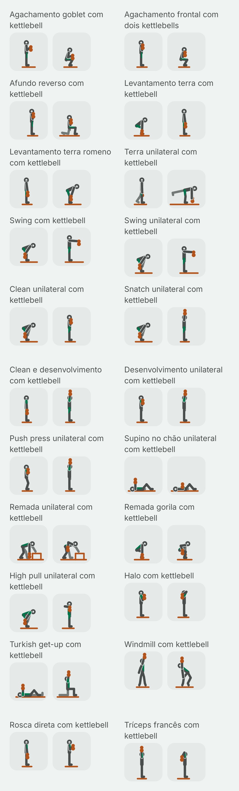
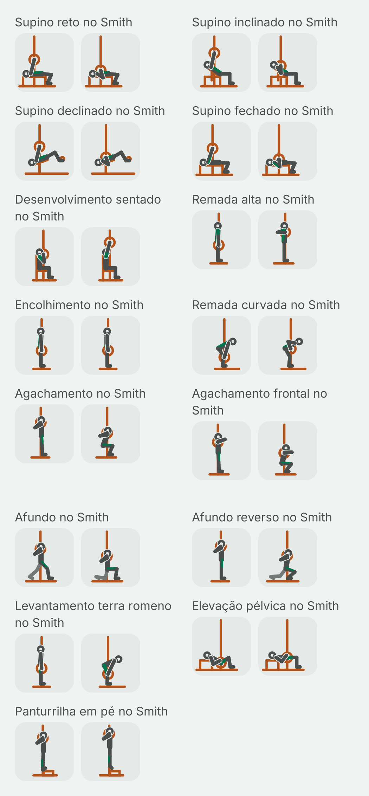
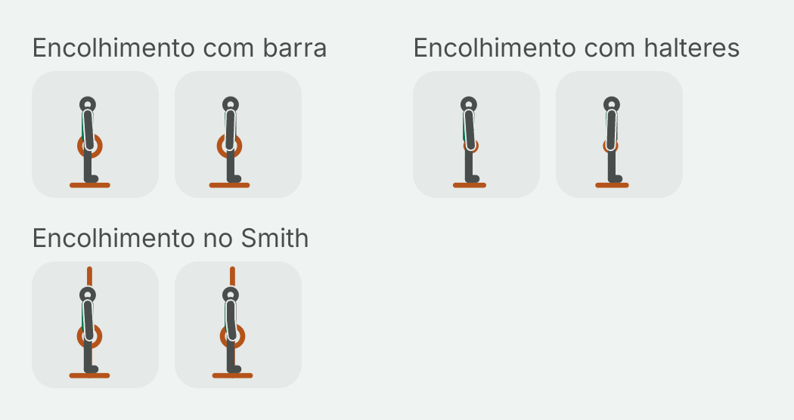
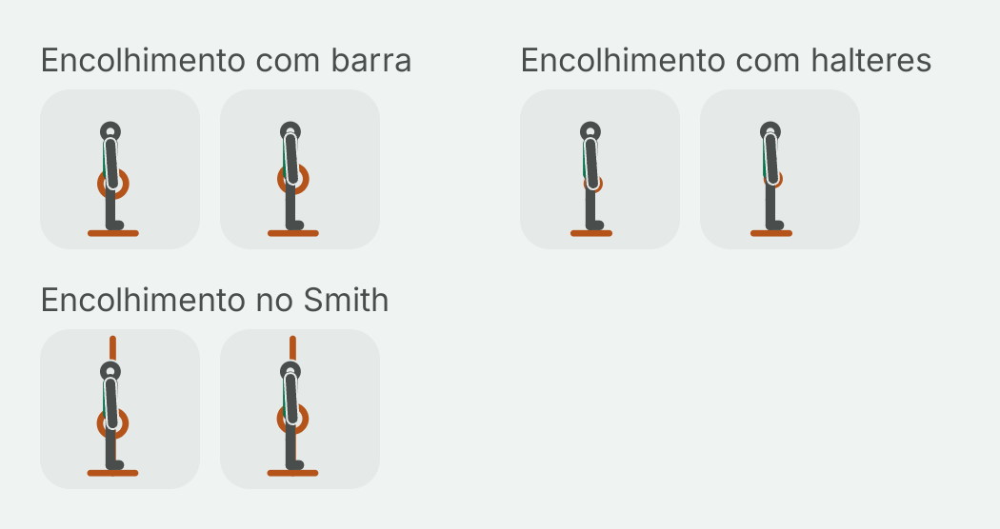

# Fase 4: figuras do último lote, kettlebell e Smith (Task L)

Data: 2026-10-31. Plano: [fase 4A, Task L](../plans/2026-10-29-phase4a-library.md#task-l-condicional-só-com-o-g1-aprovado-um-lote-de-figuras). Spec: [D3, D4, D5 e D21](../specs/2026-10-29-phase4-library-routines-design.md#mídia-do-exercício). Piloto aprovado no G1, com o equipamento em cobre: [folha do piloto](2026-10-30-phase4a-folha-piloto.md). Lotes anteriores: [barra](2026-10-31-phase4-figuras-barra.md), [halter](2026-10-31-phase4-figuras-halter.md), [polia](2026-10-31-phase4-figuras-polia.md), [peso corporal](2026-10-31-phase4-figuras-peso-corporal.md) e [máquinas](2026-10-31-phase4-figuras-maquinas.md).

Este é o último lote. Ele desenha o que ainda não tinha figura no catálogo: os 22 exercícios de kettlebell e os 15 do Smith, 37 ao todo. Não sobrou mais nada. O equipamento "outro" do catálogo tem só o levantamento terra com barra hexagonal, que entrou com o lote da barra (D4), e o catálogo não tem elástico nem outro equipamento. Por isso o `OtherFigures.kt` previsto no plano não foi criado: ficaria vazio. Com este lote, **285 dos 287 exercícios do catálogo têm figura**. Os 2 restantes estão em `ExerciseFigures.NO_FIGURE` de propósito, desde os lotes da polia e das máquinas.

## O que você está vendo

Cada exercício tem dois quadros, como nos lotes anteriores:

- **A** (à esquerda): onde a repetição começa.
- **B** (à direita): onde ela vira. É o quadro que aparece parado na lista.

O esqueleto, o traço, o cobre do equipamento, o lado de lá mais apagado e o destaque verde do músculo principal são os do piloto. Duas coisas mudaram no desenho do equipamento, e nenhuma delas mexe nos tokens nem no esqueleto (ver "Duas mudanças pequenas no renderizador").

Há oito imagens, capturadas no emulador (Pixel 8, Android 15) pelo `PilotSheetCaptureTest`, uma rodada com `-e lot kettlebell` e outra com `-e lot smith`:

| | Tema claro | Tema escuro |
| --- | --- | --- |
| **Kettlebell, 64 dp** (a miniatura da lista) | [kettlebell-light-64.png](2026-10-31-phase4-figuras-final/kettlebell-light-64.png) | [kettlebell-dark-64.png](2026-10-31-phase4-figuras-final/kettlebell-dark-64.png) |
| **Kettlebell, 360 dp** (o detalhe num celular de 412 dp) | [kettlebell-light-detail.png](2026-10-31-phase4-figuras-final/kettlebell-light-detail.png) | [kettlebell-dark-detail.png](2026-10-31-phase4-figuras-final/kettlebell-dark-detail.png) |
| **Smith, 64 dp** | [smith-light-64.png](2026-10-31-phase4-figuras-final/smith-light-64.png) | [smith-dark-64.png](2026-10-31-phase4-figuras-final/smith-dark-64.png) |
| **Smith, 360 dp** | [smith-light-detail.png](2026-10-31-phase4-figuras-final/smith-light-detail.png) | [smith-dark-detail.png](2026-10-31-phase4-figuras-final/smith-dark-detail.png) |

As folhas do detalhe são compridas (44 e 30 quadros). Abra pelos links da tabela.

Como as imagens foram feitas: as miniaturas usam a densidade do emulador (2,625×); a folha do detalhe usa 1,35×, para caberem dois quadros de 360 dp lado a lado, como nas folhas anteriores. Os PNGs estão sem compressão de paleta (não há `pngquant` nesta máquina).

## Os 37 exercícios

### Kettlebell (22)

| # | Nome no app | `stableId` |
| --- | --- | --- |
| 1 | Agachamento goblet com kettlebell | `kettlebell_squat_goblet` |
| 2 | Agachamento frontal com dois kettlebells | `kettlebell_squat_front_double` |
| 3 | Afundo reverso com kettlebell | `kettlebell_lunge_reverse_racked` |
| 4 | Levantamento terra com kettlebell | `kettlebell_deadlift` |
| 5 | Levantamento terra romeno com kettlebell | `kettlebell_deadlift_romanian` |
| 6 | Terra unilateral com kettlebell | `kettlebell_deadlift_one_leg` |
| 7 | Swing com kettlebell | `kettlebell_swing_two_hand` |
| 8 | Swing unilateral com kettlebell | `kettlebell_swing_one_hand` |
| 9 | Clean unilateral com kettlebell | `kettlebell_clean` |
| 10 | Snatch unilateral com kettlebell | `kettlebell_snatch` |
| 11 | Clean e desenvolvimento com kettlebell | `kettlebell_clean_press` |
| 12 | Desenvolvimento unilateral com kettlebell | `kettlebell_press` |
| 13 | Push press unilateral com kettlebell | `kettlebell_push_press` |
| 14 | Supino no chão unilateral com kettlebell | `kettlebell_floor_press` |
| 15 | Remada unilateral com kettlebell | `kettlebell_row` |
| 16 | Remada gorila com kettlebell | `kettlebell_gorilla_row` |
| 17 | High pull unilateral com kettlebell | `kettlebell_high_pull` |
| 18 | Halo com kettlebell | `kettlebell_halo` |
| 19 | Turkish get-up com kettlebell | `kettlebell_turkish_get_up` |
| 20 | Windmill com kettlebell | `kettlebell_windmill` |
| 21 | Rosca direta com kettlebell | `kettlebell_curl` |
| 22 | Tríceps francês com kettlebell | `kettlebell_triceps_overhead` |

### Smith (15)

| # | Nome no app | `stableId` |
| --- | --- | --- |
| 1 | Supino reto no Smith | `smith_bench_flat` |
| 2 | Supino inclinado no Smith | `smith_bench_incline` |
| 3 | Supino declinado no Smith | `smith_bench_decline` |
| 4 | Supino fechado no Smith | `smith_bench_close_grip` |
| 5 | Desenvolvimento sentado no Smith | `smith_shoulder_press` |
| 6 | Remada alta no Smith | `smith_upright_row` |
| 7 | Encolhimento no Smith | `smith_shrug` |
| 8 | Remada curvada no Smith | `smith_bent_over_row` |
| 9 | Agachamento no Smith | `smith_squat` |
| 10 | Agachamento frontal no Smith | `smith_front_squat` |
| 11 | Afundo no Smith | `smith_split_squat` |
| 12 | Afundo reverso no Smith | `smith_lunge_reverse` |
| 13 | Levantamento terra romeno no Smith | `smith_deadlift_romanian` |
| 14 | Elevação pélvica no Smith | `smith_hip_thrust` |
| 15 | Panturrilha em pé no Smith | `smith_calf_raise` |

## Duas mudanças pequenas no renderizador

O plano permitia acrescentar uma primitiva pequena dentro da DSL ou do renderizador, com teste. Usei essa permissão duas vezes. Nenhuma das duas muda uma figura já desenhada: nenhum lote anterior usava kettlebell nem trilho.

- **Trilho do Smith (`FigureProp.Rail`, nova).** A barra do Smith corre em trilhos verticais. De lado, os trilhos aparecem como uma linha vertical que passa pelo centro da anilha. Nenhuma primitiva existente desenhava uma linha vertical fixa (a `Bar` é só horizontal; um `bench` em pé daria a linha, mas misturaria os sentidos). A primitiva nova é uma linha em cobre de `top` até `bottom` num `x` fixo, com 1 linha no `FigureKinematics.propShapes`, mais `rail(x, top, bottom)` na DSL. Teste: `FigureGeometryTest.railIsAVerticalLineThatStaysPut`. Do lado do lote, o `ExerciseFiguresTest.smithBarRunsOnTheRail` exige que toda figura do Smith tenha um trilho e que a barra fique no `x` dele nos dois quadros. Entre A e B a barra só sobe ou desce, como na máquina. As poses foram calculadas para isso: a barra é o ponto fixo, e o corpo se ajusta em volta dela.
- **Kettlebell da mão de cá desenhado por cima do braço.** A primitiva `Kettlebell` já existia (alça em volta da mão e sino pendurado embaixo), mas nenhuma figura a usava. Na prévia, o recorte do braço de cá apagava o sino sempre que o antebraço apontava para cima: no rack, o kettlebell virava um crescente fino, e acima da cabeça (snatch, desenvolvimento, push press, clean e desenvolvimento, get-up, windmill, tríceps) sumia por inteiro. No lugar de mudar a forma, mudei a ordem: um kettlebell na mão de cá (de frente, em qualquer mão) é desenhado depois do braço. Fisicamente é o certo, porque no rack e acima da cabeça o sino fica apoiado no lado de fora do antebraço, voltado para quem olha. Para isso, o `FigureKinematics` ganhou `equipmentBehind`, `equipmentInFront` e `inFrontOfTheArm`, e o `figureOperations` ganhou o parâmetro `inFront` (padrão vazio). Teste: `FigureHighlightDrawingTest.aKettlebellInTheNearHandIsDrawnOverTheArm`. Ele também confere que o halter continua atrás, que o kettlebell da mão de lá continua atrás e que as duas camadas somadas são o equipamento inteiro, na ordem. **Para o controlador confirmar**, porque mexe na ordem de desenho do G1, ainda que só para o kettlebell.

O `ExerciseFigureTest` do design system (uiTest) passou no emulador depois das duas mudanças (10 de 10).

## Escolhas de desenho

### Kettlebell

- **A forma:** a alça é um anel em volta do punho e o sino é um disco cheio logo abaixo. A 64 dp, os dois juntos leem como um "8" em cobre preso à mão, diferente do anel vazio do halter e da anilha grande da barra. O `kettlebellFiguresHoldAKettlebell` exige um kettlebell nos dois quadros de cada figura e nenhum halter ou barra.
- **Posições que se repetem:** o *rack* (sino no lado de fora do antebraço, na altura do peito, cotovelo junto às costelas, antebraço quase vertical), o *goblet* (seguro pelas alças, mais à frente e mais baixo que o rack, cotovelos para baixo), o *hike* (dobrado no quadril, canelas quase verticais, sino para trás entre as coxas) e o travamento acima da cabeça (braço a 4–8° da vertical, "bíceps na orelha").
- **Balísticos (swing, clean, snatch, high pull):** o A é o hike, e o B é onde o sino para: na altura do peito (swing), no rack (clean), acima da cabeça (snatch) ou com o cotovelo alto e para trás (high pull). Os unilaterais deixam o braço livre solto, mais apagado.
- **Clean e desenvolvimento:** o A é em pé com o kettlebell pendurado (onde cada clean começa), e o B é o travamento. Assim o par não fica igual ao do snatch (A no hike) nem ao do desenvolvimento (A no rack).
- **Terra:** o sino do levantamento terra fica no chão, sob o meio do pé, com a base encostada na linha do chão. No B ele fica pendurado à frente das coxas, para não sumir atrás da perna.
- **Remadas:** a unilateral tem a base escalonada e a mão livre apoiada num banco à frente (a dica fala em "apoiar uma mão no banco", não o joelho). A gorila tem dois kettlebells: no B, um sobe até o quadril e o outro fica no chão.
- **Turkish get-up:** o A é deitado com o braço travado e o joelho de cá dobrado. O B é a meia-ajoelhada com o braço ainda travado e o olhar no sino. É o passo mais reconhecível do movimento, porque de pé ele ficaria igual a um desenvolvimento.
- **Windmill, de frente** (a exceção da Task 8): o kettlebell fica travado na mão de cá. No B, o quadril vai para o lado do peso, o tronco se inclina para o outro lado, e a mão livre desce pela perna de lá. O braço carregado fica vertical nos dois quadros.
- **Halo:** o A é com o kettlebell na frente do queixo e o B atrás do pescoço, o que mostra a volta em torno da cabeça.

### Smith

- **O trilho:** uma linha vertical do chão até perto do alto do quadro (`top` 6, dentro da margem), que passa pelo centro da anilha. A barra fica no `x` do trilho nos dois quadros.
- **Supinos:** o trilho fica onde a dica põe a barra: na parte de baixo do peito no reto e no declinado, no alto do peito no inclinado, e um pouco mais baixo no fechado. O travamento sai com o braço levemente inclinado para os pés, porque a barra do Smith não faz o "J" da barra livre.
- **Agachamentos:** os pés ficam um pouco à frente da barra, como pedem as dicas, e as pernas em pé se inclinam levemente. Na descida o tronco fica mais em pé que no agachamento livre (20° atrás, 15° na frente) e os joelhos vão mais à frente, que é o que o trilho impõe. O frontal tem os cotovelos altos e a barra no ombro, sobre o meio do pé.
- **Afundo e afundo reverso:** no afundo, o pé da frente fica bem à frente da barra e o quadril desce em linha reta. No reverso, a pessoa começa sob a barra e dá um passo para trás. O quadril desce sob a barra, então o joelho da frente avança mais que no afundo livre.
- **Terra romeno e remada curvada:** a barra desce ou sobe rente às pernas, no mesmo `x`. No B do romeno ela para na altura do joelho, com o braço inclinado em direção às pernas.
- **Elevação pélvica:** o quadril sobe em linha reta sob a barra, e o ombro desliza um pouco sobre o banco (o banco ficou 2 unidades mais comprido que o da barra livre). No B as canelas ficam verticais.
- **Panturrilha:** os dedos ficam no degrau, os joelhos esticados e a barra no alto das costas. No A as pernas se inclinam cerca de 2° para a barra continuar no trilho.

## A crítica e o que mudou

Fiz a crítica de tela nas oito folhas com as três perguntas do piloto: o movimento se entende a 64 dp? O destaque se vê? O A difere do B? Antes do emulador, as poses passaram pela prévia local dos lotes anteriores (o mesmo cálculo de cinemática, a mesma ordem de desenho e as mesmas checagens de margem e de chão, em SVG), agora com o trilho, o kettlebell por cima do braço e duas checagens novas: barra no trilho e base do sino acima da linha do chão. Saíram dela as primeiras correções:

- **Kettlebell acima da cabeça e no rack apagado pelo braço:** a mudança de ordem descrita acima.
- **Agachamentos no Smith:** o primeiro desenho punha a barra 2,5 unidades atrás do ombro. O braço resolvido caía rente ao tronco e cruzava o rosto. A barra subiu e chegou mais perto do ombro, como no agachamento com barra, e o cotovelo voltou para baixo e para trás. No frontal, a barra foi para o ombro e o cotovelo ficou alto.
- **Goblet e frontal com dois kettlebells:** a 64 dp os dois A eram iguais. O goblet foi um pouco mais para a frente e para baixo (seguro pelas alças), e o rack ficou junto ao peito.
- **Windmill:** no A, o braço carregado vertical passava pelo meio da cabeça (de frente, os ombros são um ponto só). Ele abriu 14° para o lado, e o braço livre também se abriu. A figura subiu 3 unidades (chão em 88) para o kettlebell ficar dentro da margem.
- **Remada unilateral:** a base escalonada não alcançava o chão com o quadril alto. O quadril desceu, o tronco ficou a 72° e o sino pendurado ficou longe do chão.
- **Get-up, A:** a cabeça inclinada para o sino passava da linha do chão. Agora ela olha 6° para cima.
- **Trilho na panturrilha:** de pé, o corpo esconde quase todo o trilho. O alto de todos os trilhos subiu de 10 para 6, e o trecho acima da cabeça aparece.

Nas folhas do emulador nenhum achado foi alto. Nada pediu nova captura além da que já tinha o trilho em 6.

### Achados altos

Nenhum. A única questão que pede a confirmação do controlador é a ordem de desenho do kettlebell, acima.

### Achados médios: ficam, com o motivo

- **M1. Quatro B iguais no kettlebell:** o snatch, o desenvolvimento, o push press e o clean e desenvolvimento terminam no mesmo travamento acima da cabeça, então na lista os quatro mostram o mesmo quadro. O que os separa é o A (hike, rack, rack com o joelho dobrado, kettlebell pendurado) e o nome. É o mesmo caso dos pares "iguais de propósito" dos lotes anteriores.
- **M2. Halo:** a dica pede o kettlebell de cabeça para baixo, e a primitiva sempre pendura o sino abaixo da mão. A figura mostra o caminho em volta da cabeça, mas não a pegada invertida. Corrigir isso pede uma orientação na primitiva, ou seja, mudança de renderizador.
- **M3. Tríceps francês e halo, quadro B:** com a mão atrás da cabeça, o sino (por cima do braço) cai sobre a nuca e o alto das costas. Lê como "atrás da cabeça", mas encosta no contorno da cabeça.
- **M4. Turkish get-up:** são sete passos e a figura mostra dois (deitado e meia-ajoelhada). O "ficar de pé" não aparece de propósito, porque se confundiria com o desenvolvimento.
- **M5. Windmill:** de frente, os ombros são um ponto só (como na flexão lateral do lote do halter). O braço carregado e o braço livre saem do mesmo lugar, e os pés virados a 45° não aparecem.
- **M6. Remada gorila:** de lado, o kettlebell que fica no chão some quase todo atrás da canela. Aparece só uma ponta em cobre.
- **M7. Panturrilha no Smith:** de pé, o trilho fica atrás do corpo. O que identifica o Smith é o trecho acima da cabeça e o trecho sob o calcanhar.
- **M8. Supino fechado e supino reto no Smith:** de lado não se vê a largura da pegada. A diferença é o ponto do peito onde a barra desce (um pouco mais baixo no fechado).
- **M9. Afundo reverso no Smith:** com o quadril preso sob a barra, o joelho da frente passa bem da ponta do pé no B. É o que a máquina impõe a quem fica sob a barra, como a dica pede, e não um erro de técnica desenhado.

### Achados baixos

- O swing com uma mão e o com duas diferem só pelo braço livre (solto, mais apagado).
- O B do terra com kettlebell é igual ao A do terra romeno: é o mesmo "em pé com o kettlebell à frente das coxas".
- A alça do kettlebell, com o traço fino, quase se fecha num disco pequeno. A 64 dp o "8" lê bem. No detalhe aparece um ponto claro no meio da alça.
- O trilho passa pelo degrau na panturrilha e pelo banco no supino. É uma linha atrás, sem peso.
- Tema escuro: o lado de lá (o braço livre, a perna de trás, o segundo kettlebell da remada gorila) fica apagado, como no piloto, com o contraste já testado.

Nenhum achado é de cor, toque ou texto: a folha não é uma tela do app.

### Revisão de conteúdo (D21a): pose contra as dicas e a anatomia

Conferi cada pose com as quatro dicas do exercício (`files/exercise_cues/en.json`) e com a `ExerciseAnatomyTable`. O destaque sai da anatomia, pela tabela da decisão 9: frente da coxa nos agachamentos e afundos, quadril e trás da coxa nos terras, swings, clean e snatch, ombro nos desenvolvimentos, no halo, no get-up e na remada alta, trás do tronco nas remadas e no encolhimento, frente do tronco nos supinos e no windmill (abdominais), frente do braço na rosca, trás do braço no tríceps e no supino fechado, trás da canela na panturrilha.

Corrigidos:

- **C1. Levantamento terra com kettlebell:** a dica põe o sino sob o meio do pé. A mão ficou 2,5 unidades à frente do tornozelo, e a base do sino encosta na linha do chão.
- **C2. Swing:** a dica pede "canelas quase verticais" e "o sino flutua até a altura do peito". O hike tem a canela a 2° da vertical, e o B tem o braço a 94°, com a mão logo abaixo do ombro.
- **C3. Desenvolvimento unilateral:** a dica pede o antebraço vertical no rack e a subida "para cima e um pouco para fora". O rack tem o antebraço a 8°, e o travamento, a 8° da vertical.
- **C4. Afundo no Smith:** a dica põe o pé da frente à frente da barra. O tornozelo fica cerca de 14 unidades à frente do trilho.
- **C5. Agachamento no Smith:** a dica põe os pés um pouco à frente da barra. Ficam 3 unidades à frente.

Conferidos sem mudança, lado a lado com a dica: o goblet tem os cotovelos para baixo e agacha entre os joelhos com o peito alto; o frontal com dois kettlebells tem o rack com o cotovelo junto às costelas; o afundo reverso com rack mantém o tronco alto e desce o joelho de trás perto do chão; o terra romeno leva o sino rente às pernas até abaixo dos joelhos; o unilateral segura o peso na mão oposta à perna de apoio, com a perna livre subindo atrás; o clean termina no rack; o snatch e o push press terminam com o bíceps na orelha, e o push press começa com o joelho dobrado e o tronco em pé; o supino no chão começa travado sobre o ombro e termina com o braço no chão; a remada leva o sino ao quadril com o cotovelo junto; a gorila rema um enquanto o outro fica no chão; o high pull termina com o cotovelo alto e para trás e a mão na altura do peito; o get-up mantém o braço travado e vertical nos dois quadros; o windmill mantém o braço carregado vertical e desce a mão livre pela outra perna; a rosca mantém os cotovelos junto ao corpo; o tríceps aponta os cotovelos para cima. No Smith: os supinos descem a barra no ponto do peito que a dica pede, com os pés no chão (as canelas presas no declinado); o desenvolvimento passa a barra à frente do rosto e começa na altura do queixo, com as costas no encosto; a remada alta leva a barra rente ao corpo, com o cotovelo na altura do ombro; a remada curvada tem o tronco abaixo de 45° e a barra no alto do abdômen; o frontal tem os cotovelos altos e o tronco em pé; o afundo reverso dá o passo para trás sob a barra; o romeno para com as costas retas e a barra nos joelhos; a elevação pélvica termina com ombros, quadril e joelhos alinhados e a canela vertical; a panturrilha tem a ponta dos pés no degrau e os joelhos esticados.

Ficam com o motivo os médios M1 a M9, limites do esqueleto (ombro sem elevação nem largura, braço sem encurtamento), da vista de lado ou da primitiva do kettlebell (o sino sempre pendurado).

## Fechamento das figuras do catálogo

### Por família

| Família | Arquivo | Figuras | Do catálogo |
| --- | --- | ---: | --- |
| Barra (com EZ e barra hexagonal) | `BarbellFigures.kt` | 49 | 48 de barra + `trap_bar_deadlift` |
| Halter | `DumbbellFigures.kt` | 56 | 56 |
| Polia | `CableFigures.kt` | 45 | 46, menos o Pallof |
| Peso corporal | `BodyweightFigures.kt` | 46 | 46 |
| Máquinas (placas e anilhas) | `MachineFigures.kt` | 52 | 53, menos a rotação de tronco |
| Kettlebell | `KettlebellFigures.kt` | 22 | 22 |
| Smith | `SmithFigures.kt` | 15 | 15 |
| **Total** | | **285** | **de 287** |

Os 20 do piloto estão dentro das famílias. O `everyCatalogExerciseHasAFigure` exige uma figura para todo id do catálogo fora de `NO_FIGURE`, e o `noFamilyTableIsTooLarge` garante que nenhum exercício está em duas famílias e que nenhuma tabela passa de 60 figuras.

### `NO_FIGURE` (2), sem acréscimos neste lote

- `cable_pallof_press`: a vista de lado não mostra uma força anti-rotação; o ícone do equipamento é mais claro (lote da polia, aprovado pelo controlador).
- `selectorized_torso_rotation`: o tronco gira em torno do próprio eixo, o que nem a vista de lado nem a de frente mostram; os dois quadros seriam a mesma pessoa sentada (lote das máquinas, aprovado pelo controlador).

Nenhum exercício de kettlebell ou de Smith foi para a lista. Os candidatos eram o halo (um círculo em volta da cabeça), o windmill e o get-up (vários passos). Os três têm um A e um B que contam o exercício sem enganar (M2, M4 e M5).

### Encolhimentos (para a continuação da elevação do ombro)

O esqueleto não tem cintura escapular: o ombro é um ponto preso ao tronco e não sobe. Nestes exercícios os quadros diferem só por um leve balanço do braço (achado A1 do lote da barra):

- `barbell_shrug` (Encolhimento com barra)
- `dumbbell_shrug` (Encolhimento com halteres)
- `smith_shrug` (Encolhimento no Smith, deste lote: a barra fica no trilho, e o braço só se dobra 3°)

São os três encolhimentos do catálogo. Nenhum outro exercício depende só da elevação do ombro: as remadas altas passam, porque o cotovelo sobe.

## Testes

- `:screens` (`commonTest`, `ExerciseFiguresTest`), 5 novos: `kettlebellFamilyIsComplete`, `smithFamilyIsComplete`, `everyCatalogExerciseHasAFigure`, `kettlebellFiguresHoldAKettlebell` e `smithBarRunsOnTheRail`. O `noFamilyTableIsTooLarge` passa a esperar as sete famílias, e o `bothFramesHaveTheSameEquipment` trata o trilho como equipamento fixo.
- `:designsystem` (`commonTest`), 2 novos: `FigureGeometryTest.railIsAVerticalLineThatStaysPut` e `FigureHighlightDrawingTest.aKettlebellInTheNearHandIsDrawnOverTheArm`.
- `ExerciseInfoScreenTest.exerciseWithoutAFigureShowsTheEquipmentPlaceholder` escolhia em tempo de execução o primeiro exercício do catálogo sem figura, e com `firstOrNull` passaria em silêncio sem nenhum. Agora ele pega um id de `NO_FIGURE` (hoje o `cable_pallof_press`) e confere que ele não tem figura. Rodou no emulador pela trava, com a classe inteira: 26 de 26.
- No emulador também passaram o `FiguresGalleryPageTest` (a página "Figuras" com as 285 figuras) e o `ExerciseFigureTest` do design system.
- Mínimos do CI: `MIN_HOST_TESTS` 1092 → 1099, `MIN_SCREENS_IOS_TESTS` 647 → 652 e `MIN_DS_IOS_TESTS` 375 → 377, com a linha por classe.
- Suítes de host completas: `:screens` 179, `:designsystem` 101 e `:app:testDebugUnitTest` 524, sem falhas (o `:app` rodou por causa da mudança no renderizador).
- `tools/check-design-tokens.ps1`: limpo. As coordenadas de pose e do trilho são dados sem unidade.

## Tamanho

APK debug (`./gradlew :app:clean :app:assembleDebug`, `tools/check-apk-budget.ps1`), comparado com o APK do lote das máquinas (`2482a98`, a base desta branch).

- Base (lote das máquinas): 24.436.324 bytes.
- Este lote: **24.452.708 bytes. Delta do APK: +16.384 bytes**, um salto de alinhamento do empacotador (16 KiB).
- Nos `.dex` de dentro do APK: +11.468 bytes comprimidos (+38.084 sem compressão) para 37 exercícios (74 poses), incluindo o trilho e a ordem do kettlebell no renderizador.
- Pelo script: crescimento de 800.365 bytes sobre a base do orçamento, **248.211 bytes livres** no orçamento de 1 MiB da fase 4.
- Na conta conservadora dos lotes anteriores (o crescimento que sobrou depois do lote das máquinas, 795.493, mais o dex comprimido deste lote, 11.468): **241.615 bytes livres**.
- As duas tabelas novas são pequenas (22 e 15 figuras) e ficam bem abaixo do teto de 60 do `noFamilyTableIsTooLarge`. Pela medida do lote das máquinas (52 figuras, 20.488 bytes no `<clinit>`), cada uma fica abaixo de 9 KB, longe dos 32 KB da regra da Task 8. Não medi o método no dex.

## O que não foi provado

- **As figuras num iPhone.** Os testes de iOS rodam só no CI (e os mínimos subiram para isso).
- **A leitura por quem treina.** Só o agente que desenhou olhou as figuras, como no piloto e nos lotes anteriores.
- **Celular físico.** Só o emulador.
- **Referências.** Nenhuma imagem de referência foi aberta ou decalcada. As poses vêm de conhecimento geral de execução e das dicas do próprio app, e foram conferidas só nas capturas do nosso renderizador. Não há nenhum asset gerado por IA.

## Elevação do ombro nos encolhimentos (2026-10-31)

Continuação do achado A1 do [lote da barra](2026-10-31-phase4-figuras-barra.md), pela decisão do controlador: uma elevação de ombro opcional na pose, padrão 0, sem mudar as proporções da D3 (nota datada na [spec](../specs/2026-10-29-phase4-library-routines-design.md), em "Esqueleto").

- **Modelo.** A `FigurePose` ganhou `shoulderLift`, em unidades da caixa. A cinemática calcula o topo do tronco como antes e sobe só a junta do ombro, onde os braços nascem, ao longo da linha do tronco, na direção do pescoço. O quadril, o topo do tronco, o pescoço, a cabeça e o comprimento de cada osso não mudam. O valor é limitado a `FigureSkeleton.SHOULDER_LIFT_MAX` = 3, o comprimento do pescoço (cerca de um sexto do tronco): o ombro chega à base da cabeça e não passa dela. O valor está fixado no `IllustrationTokensTest`.
- **DSL.** `shoulderLift(x)` dentro de um quadro. Os três encolhimentos (`barbell_shrug`, `dumbbell_shrug`, `smith_shrug`) usam no quadro B o `SHRUG_LIFT`, que é o máximo (3). O braço fica esticado e com o mesmo ângulo do quadro A (176°, ou 176,6° no Smith), então a barra ou os halteres sobem 3 unidades em linha reta junto com as mãos. No Smith, a barra continua no trilho (`smithBarRunsOnTheRail`). Antes, os quadros B tinham um leve balanço do braço (182° no lugar de 176°, ou 179,6°/173,6° no Smith), que deixou de ser necessário.
- **Na tela.** São 3 unidades: cerca de 5 px numa miniatura de 64 dp com a densidade do emulador (2,625×) e 10,8 dp no detalhe de 360 dp. A 64 dp a diferença é pequena, mas aparece lado a lado: o braço começa encostado na cabeça e a anilha fica mais alta. No detalhe ela é clara.
- **Nenhuma outra figura mudou.** Com 0, o ombro é o próprio topo do tronco, sem nenhuma conta a mais. Um despejo temporário dos bits de cada junta das 570 poses (285 figuras × 2 quadros), feito antes e depois da mudança, diferiu só nos três quadros B dos encolhimentos. O teste fica no design system: o `noShoulderLiftLeavesEveryJointBitIdentical` compara, bit a bit, a cinemática nova com uma cópia da antiga em 204 poses. No `:screens`, o `onlyTheShrugsLiftTheShoulders` garante que só esses três quadros usam a elevação.

Capturas no emulador (Pixel 8, Android 15) pelo `PilotSheetCaptureTest` com `-e lot shrugs`, um filtro novo que junta os três encolhimentos das famílias. Rodou uma vez antes da mudança e outra depois. Em cada folha, o quadro A fica à esquerda e o B à direita.

| | Antes | Depois |
|---|---|---|
| **64 dp, claro** | [shrugs-before-light-64.png](2026-10-31-phase4-figuras-final/shrugs-before-light-64.png) | [shrugs-after-light-64.png](2026-10-31-phase4-figuras-final/shrugs-after-light-64.png) |
| **64 dp, escuro** | [shrugs-before-dark-64.png](2026-10-31-phase4-figuras-final/shrugs-before-dark-64.png) | [shrugs-after-dark-64.png](2026-10-31-phase4-figuras-final/shrugs-after-dark-64.png) |
| **360 dp, claro** | [shrugs-before-light-detail.png](2026-10-31-phase4-figuras-final/shrugs-before-light-detail.png) | [shrugs-after-light-detail.png](2026-10-31-phase4-figuras-final/shrugs-after-light-detail.png) |
| **360 dp, escuro** | [shrugs-before-dark-detail.png](2026-10-31-phase4-figuras-final/shrugs-before-dark-detail.png) | [shrugs-after-dark-detail.png](2026-10-31-phase4-figuras-final/shrugs-after-dark-detail.png) |

Testes novos: 3 no `FigureGeometryTest` do design system (`noShoulderLiftLeavesEveryJointBitIdentical`, `aShoulderLiftRaisesTheShoulderAlongTheTrunk`, que confere a subida exata ao longo do tronco, os braços com o mesmo comprimento e o resto parado, e `theShoulderLiftIsClamped`) e 2 no `ExerciseFiguresTest` (`shrugsRaiseTheShouldersInFrameB`, que pede pelo menos 2 unidades de subida do ombro e da mão, a cabeça parada e o braço esticado, e `onlyTheShrugsLiftTheShoulders`). Os mínimos do CI subiram: `MIN_HOST_TESTS` 1099 → 1104, `MIN_DS_IOS_TESTS` 377 → 380 e `MIN_SCREENS_IOS_TESTS` 652 → 654.

O que não foi provado: o iPhone (só a compilação local; os testes de iOS rodam no CI), um celular físico e a leitura por quem treina. Só o agente que fez a mudança olhou as capturas.
