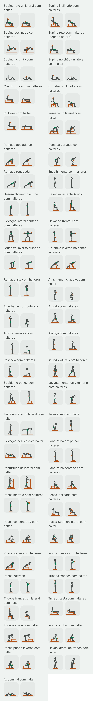
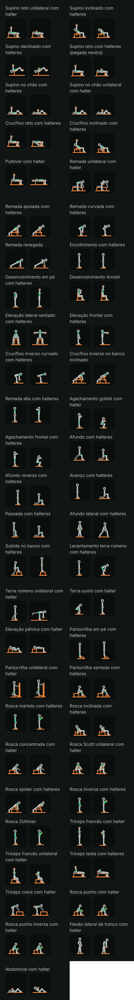

# Fase 4: figuras do lote do halter (Task L)

Data: 2026-10-31. Plano: [fase 4A, Task L](../plans/2026-10-29-phase4a-library.md#task-l-condicional-só-com-o-g1-aprovado-um-lote-de-figuras). Spec: [D3, D4, D5 e D21](../specs/2026-10-29-phase4-library-routines-design.md#mídia-do-exercício). Piloto aprovado no G1, com o equipamento em cobre: [folha do piloto](2026-10-30-phase4a-folha-piloto.md). Lote anterior: [barra](2026-10-31-phase4-figuras-barra.md).

Este é o segundo lote depois do piloto. Ele desenha todos os exercícios de halter do catálogo que ainda não tinham figura: 51 exercícios novos. Com os 5 de halter do piloto, a família do halter fica completa, com 56 figuras.

## O que você está vendo

Cada exercício tem dois quadros, como no piloto e no lote da barra:

- **A** (à esquerda): onde a repetição começa.
- **B** (à direita): onde ela vira. É o quadro que aparece parado na lista.

As figuras são as mesmas do piloto: o mesmo esqueleto, o mesmo traço, o equipamento em cobre, o lado de lá do corpo mais apagado e o músculo principal em verde. Nada mudou no renderizador nem nos tokens. O lote é só dado (as poses) e teste.

Há quatro imagens, capturadas no emulador (Pixel 8, Android 15) pelo `PilotSheetCaptureTest` com `-e lot dumbbell`, que desenha só as figuras novas da família:

| | Tema claro | Tema escuro |
| --- | --- | --- |
| **64 dp** (a miniatura da lista) | [dumbbell-light-64.png](2026-10-31-phase4-figuras-halter/dumbbell-light-64.png) | [dumbbell-dark-64.png](2026-10-31-phase4-figuras-halter/dumbbell-dark-64.png) |
| **360 dp** (o detalhe num celular de 412 dp) | [dumbbell-light-detail.png](2026-10-31-phase4-figuras-halter/dumbbell-light-detail.png) | [dumbbell-dark-detail.png](2026-10-31-phase4-figuras-halter/dumbbell-dark-detail.png) |

As folhas do detalhe são compridas (102 quadros cada). Abra pelos links da tabela.

Como as imagens foram feitas: as miniaturas usam a densidade do emulador (2,625×); a folha do detalhe usa 1,35×, para caberem dois quadros de 360 dp lado a lado, como nas folhas anteriores. Os PNGs estão sem compressão de paleta (não há `pngquant` nesta máquina).

## Os 51 exercícios

| # | Nome no app | `stableId` |
| --- | --- | --- |
| 1 | Supino reto unilateral com halter | `dumbbell_bench_one_arm` |
| 2 | Supino inclinado com halteres | `dumbbell_bench_incline` |
| 3 | Supino declinado com halteres | `dumbbell_bench_decline` |
| 4 | Supino reto com halteres (pegada neutra) | `dumbbell_bench_neutral` |
| 5 | Supino no chão com halteres | `dumbbell_floor_press` |
| 6 | Supino no chão unilateral com halter | `dumbbell_floor_press_one_arm` |
| 7 | Crucifixo reto com halteres | `dumbbell_fly_flat` |
| 8 | Crucifixo inclinado com halteres | `dumbbell_fly_incline` |
| 9 | Pullover com halter | `dumbbell_pullover` |
| 10 | Remada unilateral com halter | `dumbbell_row_one_arm` |
| 11 | Remada apoiada com halteres | `dumbbell_row_chest_supported` |
| 12 | Remada curvada com halteres | `dumbbell_row_bent_over` |
| 13 | Remada renegada | `dumbbell_row_renegade` |
| 14 | Encolhimento com halteres | `dumbbell_shrug` |
| 15 | Desenvolvimento em pé com halteres | `dumbbell_press_standing` |
| 16 | Desenvolvimento Arnold | `dumbbell_press_arnold` |
| 17 | Elevação lateral sentado com halteres | `dumbbell_raise_lateral_seated` |
| 18 | Elevação frontal com halteres | `dumbbell_raise_front` |
| 19 | Crucifixo inverso curvado com halteres | `dumbbell_fly_reverse` |
| 20 | Crucifixo inverso no banco inclinado | `dumbbell_fly_reverse_incline` |
| 21 | Remada alta com halteres | `dumbbell_upright_row` |
| 22 | Agachamento goblet com halter | `dumbbell_squat_goblet` |
| 23 | Agachamento frontal com halteres | `dumbbell_squat_front` |
| 24 | Afundo com halteres | `dumbbell_split_squat` |
| 25 | Afundo reverso com halteres | `dumbbell_lunge_reverse` |
| 26 | Avanço com halteres | `dumbbell_lunge_forward` |
| 27 | Passada com halteres | `dumbbell_lunge_walking` |
| 28 | Afundo lateral com halteres | `dumbbell_lunge_lateral` |
| 29 | Subida no banco com halteres | `dumbbell_step_up` |
| 30 | Levantamento terra romeno com halteres | `dumbbell_deadlift_romanian` |
| 31 | Terra romeno unilateral com halter | `dumbbell_deadlift_romanian_one_leg` |
| 32 | Terra sumô com halter | `dumbbell_deadlift_sumo` |
| 33 | Elevação pélvica com halter | `dumbbell_hip_thrust` |
| 34 | Panturrilha em pé com halteres | `dumbbell_calf_raise_standing` |
| 35 | Panturrilha unilateral com halter | `dumbbell_calf_raise_one_leg` |
| 36 | Panturrilha sentado com halteres | `dumbbell_calf_raise_seated` |
| 37 | Rosca martelo com halteres | `dumbbell_curl_hammer` |
| 38 | Rosca inclinada com halteres | `dumbbell_curl_incline` |
| 39 | Rosca concentrada com halter | `dumbbell_curl_concentration` |
| 40 | Rosca Scott unilateral com halter | `dumbbell_curl_preacher` |
| 41 | Rosca spider com halteres | `dumbbell_curl_spider` |
| 42 | Rosca inversa com halteres | `dumbbell_curl_reverse` |
| 43 | Rosca Zottman | `dumbbell_curl_zottman` |
| 44 | Tríceps francês com halter | `dumbbell_triceps_overhead_two_hands` |
| 45 | Tríceps francês unilateral com halter | `dumbbell_triceps_overhead_one_arm` |
| 46 | Tríceps testa com halteres | `dumbbell_triceps_lying` |
| 47 | Tríceps coice com halter | `dumbbell_triceps_kickback` |
| 48 | Rosca punho com halter | `dumbbell_wrist_curl` |
| 49 | Rosca punho inversa com halter | `dumbbell_wrist_curl_reverse` |
| 50 | Flexão lateral de tronco com halter | `dumbbell_side_bend` |
| 51 | Abdominal com halter | `dumbbell_crunch` |

## Escolhas de desenho

Com as primitivas que o piloto já tinha, sem nenhuma nova:

- **Vista de frente** (a exceção da Task 8, já usada na elevação lateral do piloto): a elevação lateral sentado, o afundo lateral e a flexão lateral de tronco. Os três acontecem no plano frontal, e de lado não se veriam. Na elevação lateral sentado, o banco visto pela ponta é uma caixa entre os joelhos abertos.
- **Banco inclinado de bruços** (remada apoiada, crucifixo inverso no banco inclinado, rosca spider): o encosto é um assento inclinado cuja haste apoia num banco reto, como o encosto do supino inclinado com barra; a pessoa fica de bruços nele, nas pontas dos pés.
- **Remada unilateral:** o joelho e a mão de lá apoiam no banco (o lado de lá, mais apagado); a perna e o braço da frente são os que trabalham.
- **Remada renegada:** a prancha alta sobre os dois halteres, com os halteres no chão e só as pontas dos pés declaradas no chão.
- **Panturrilha unilateral:** a mão livre segura um poste, desenhado como uma caixa estreita e alta; a perna livre fica dobrada atrás.
- **Panturrilha sentado:** os halteres apoiam nos joelhos (o halter preso ao joelho, não à mão), e as mãos os seguram; as pontas dos pés ficam no degrau e o joelho sobe com o calcanhar.
- **Subida no banco:** a caixa tem a altura do joelho; o quadro A tem o pé inteiro em cima e o outro no chão, o B, os dois pés em cima.
- **Terra romeno unilateral:** o apoio é a perna da frente (com o destaque), e o halter fica na mão de lá, a oposta, como pede a dica.
- **Avanço e afundo reverso:** o fundo é o mesmo desenho; o avanço começa em pé sobre o pé de trás, e o afundo reverso, sobre o pé da frente.

## A crítica e o que mudou

Fiz a crítica de tela nas quatro folhas com as três perguntas do piloto: o movimento se entende a 64 dp? O destaque se vê? O A difere do B? Antes da folha do emulador, as poses passaram pela prévia local do lote da barra (o mesmo cálculo de cinemática, a mesma ordem de desenho e as mesmas checagens de margem e de chão, em SVG), onde saíram as primeiras correções:

- **Flexão lateral de tronco:** no primeiro desenho, o braço do halter caía por cima do tronco nos dois quadros e o B parecia só alguém inclinado. O tronco passou a inclinar 36°, o braço do halter fica pendurado ao lado, e a mão livre vai à cintura, o que separa os dois braços do tronco.
- **Afundo lateral:** os dois braços, pendurados quase na vertical a partir do ponto do ombro, cobriam o tronco na vista de frente; abriram um pouco, como no início da elevação lateral do piloto.
- **Panturrilha unilateral:** o apoio da mão livre era uma barra solta no ar (a primitiva da barra fixa) e lia como um defeito; virou um poste (uma caixa estreita, alta, no chão).
- **Rosca concentrada:** no quadro B, o antebraço subia rente ao braço e os dois viravam um borrão a 64 dp; o antebraço para mais aberto, num "V".
- **Desenvolvimento Arnold:** o quadro A era quase o do desenvolvimento sentado; o cotovelo passou a ir à frente do peito, com o halter diante do rosto.
- **Elevação lateral sentado:** os halteres do quadro A batiam nas laterais da caixa do banco; os braços abriram um pouco.

### Achados altos

- **A1 (de novo). Encolhimento com halteres: A e B quase iguais.** É o mesmo limite do encolhimento com barra (achado A1 do lote da barra): o esqueleto não tem cintura escapular, o ombro não sobe, e os quadros diferem só por um leve balanço do braço. **Não corrigido:** pede uma mudança no esqueleto do design system (um campo de elevação do ombro na `FigurePose`), que mexe na regra de proporções fixas da D3. O controlador aceitou o A1 por ora, para rever se mais exercícios escapulares precisassem; este é o segundo (a remada alta e a remada alta com halteres passam, porque o cotovelo sobe). Fica como decisão do controlador.

### Achados da folha: corrigidos

- **Elevação pélvica com halter:** o halter, preso ao quadril, ficava escondido sob o tronco e a coxa, e a 64 dp não se via equipamento nenhum. Agora fica nas mãos, logo à frente do quadril (as duas mãos o seguram, como diz a dica), e o anel aparece nos dois quadros, ainda pequeno (o halter tem raio 4, metade da anilha da barra). Folha capturada de novo depois disso.

### Achados médios: ficam, com o motivo

- **M1. Crucifixo reto e crucifixo inclinado, quadro B:** os braços abrem para o lado, na direção de quem olha, e numa vista de lado o braço apareceria encurtado; o esqueleto não encurta osso. O B mostra o braço quase esticado descendo ao lado do banco (no reto, em diagonal na direção do quadril, porque o chão não deixa o braço cair na vertical; no inclinado, pendurado). Lê como "braços abertos e baixos", diferente do supino (antebraço vertical), mas a mão não fica onde estaria de fato. É o mesmo limite do M1 do lote da barra (remada alta).
- **M2. Crucifixo inverso curvado e no banco inclinado, quadro B:** pelo mesmo motivo, os braços que abrem para o lado são desenhados varrendo para trás, até a altura das costas. Lê como "braços para trás, costas apertadas", com o ombro em verde, mas não mostra a abertura lateral.
- **M3. Vista de frente da elevação lateral sentado:** de frente, as coxas viriam na direção de quem olha; são desenhadas abertas para os lados, com o banco (uma caixa) entre os joelhos. Lê como "sentado num banco" com o banco à vista, mas os joelhos ficam mais abertos que o normal.
- **M4. Rosca punho e rosca punho inversa:** como no lote da barra (M2 de lá), não há mão no esqueleto, então quem mexe é o antebraço inteiro sobre a coxa, e as duas têm o mesmo desenho.
- **M5. Rosca inclinada, quadro A:** o braço pendurado passa sobre a haste do encosto e o halter fica na altura do banco; a 64 dp o quadro é carregado, mas o braço vazado lê na frente. No detalhe se vê bem.
- **M6. Terra sumô com halter:** como o sumô com barra (M6 de lá), a largura dos pés e os dedos para fora não aparecem de lado.

### Achados baixos

- A rosca direta, a martelo, a inversa e a Zottman têm o mesmo desenho; só o destaque muda (bíceps; bíceps e antebraço; antebraço; antebraço e bíceps). A pegada não aparece de lado.
- O supino com pegada neutra é o supino reto com o cotovelo mais junto ao corpo; o supino no chão unilateral é o supino no chão com o braço livre estendido no chão (mais apagado).
- O avanço e o afundo reverso têm o mesmo fundo; muda onde a figura está em pé no quadro A.
- O desenvolvimento em pé e o sentado têm os mesmos braços; o Arnold difere só no quadro A (a rotação das mãos não aparece).
- A remada renegada mostra o halter do braço de apoio em cobre cheio por trás do braço apagado; lê como "halter no chão".
- Tema escuro: o lado de lá (o joelho e a mão no banco da remada unilateral, a perna de trás dos afundos) fica apagado, como no piloto, com contraste já testado.

Nenhum achado é de cor, toque ou texto: a folha não é uma tela do app.

### Revisão de conteúdo (D21a): pose contra as dicas e a anatomia

Conferi cada pose com as quatro dicas do exercício (`files/exercise_cues/en.json`) e com a `ExerciseAnatomyTable`. O destaque sai da anatomia, pela tabela da decisão 9 (por exemplo: tronco atrás nas remadas, ombro nos crucifixos inversos, frente da coxa no afundo lateral, frente do tronco na flexão lateral e no abdominal).

Corrigidos:

- **C1. Elevação pélvica com halter:** a dica pede segurar o halter com as duas mãos; o halter passou às mãos, sobre o quadril (ver acima).
- **C2. Flexão lateral de tronco:** a dica diz "deslize o halter pela perna" e "não incline para a frente nem para trás"; o desenho é de frente, o tronco inclina para o lado do halter e o braço desce rente à perna.
- **C3. Terra romeno unilateral:** a dica pede o halter na mão oposta à perna de apoio; o apoio é a perna da frente (com o destaque nos posteriores) e o halter fica na mão de lá.

Conferidos sem mudança: o supino unilateral segura o banco com a mão livre; o inclinado fica perto de 35° e desce ao alto do peito; o declinado prende as pernas no rolo; o supino no chão para com o braço no chão; o pullover leva o halter atrás da cabeça com os cotovelos levemente dobrados; a remada unilateral tem joelho e mão no banco, as costas quase niveladas e o cotovelo junto ao corpo; a apoiada mantém o peito no encosto; a curvada rema em direção ao quadril; a renegada começa em prancha alta sobre os halteres; o desenvolvimento em pé não inclina o tronco; a elevação frontal para na altura do ombro; o goblet segura o halter contra o peito e desce com o peito alto; o frontal mantém os cotovelos altos; o afundo lateral tem a outra perna esticada; a subida no banco usa uma caixa da altura do joelho com o pé inteiro em cima; a panturrilha sentado apoia os halteres nos joelhos; a rosca inclinada deixa o braço atrás da linha do corpo; a concentrada apoia o braço na coxa; a spider tem o braço vertical e parado; o tríceps francês leva o cotovelo para a frente, junto à cabeça; o coice mantém o braço paralelo ao chão; o abdominal tira as escápulas do chão com o queixo recolhido.

Ficam com o motivo: A1, M1, M2 e M4, todos limites do esqueleto ou da vista de lado (ombro sem elevação, braço sem encurtamento de perspectiva e falta de mão).

## Tamanho

APK debug (`./gradlew :app:clean :app:assembleDebug`, `tools/check-apk-budget.ps1`):

- Lote da barra (`10bbc76`; a base desta branch, `33c9e78`, só muda um teste de UI): 24.403.556 bytes, crescimento de 751.213 sobre a base, 297.363 bytes livres no orçamento de 1 MiB da fase 4.
- Este lote: 24.419.940 bytes, crescimento de 767.597. **Delta: +16.384 bytes (16 KiB) para 51 exercícios (102 poses), cerca de 160 bytes por pose no APK** (o APK cresce em passos de 4 KiB de alinhamento, então o número por pose é aproximado). Ficam **280.979 bytes** livres.
- O maior método da tabela (`DumbbellFigures.<clinit>`, 56 figuras) tem 18.503 bytes de bytecode, abaixo dos 32 KB da regra da Task 8 (o da barra tem 15.892). A tabela continua na DSL.

Os lotes que faltam (174 exercícios) devem custar perto de 60 KB pela mesma conta.

## O que não foi provado

- **As figuras num iPhone.** Os testes de iOS rodam só no CI.
- **A leitura por quem treina.** Só o agente que desenhou olhou as figuras, como no piloto e no lote da barra.
- **Celular físico.** Só o emulador.
- **Referências.** Nenhuma imagem de referência foi aberta ou decalcada. As poses vêm de conhecimento geral de execução e das dicas do próprio app, e foram conferidas só nas capturas do nosso renderizador. Não há nenhum asset gerado por IA.
