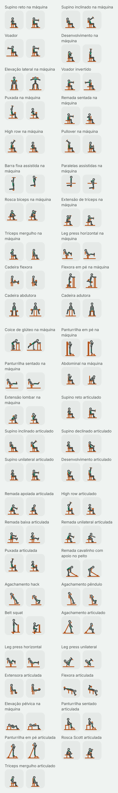
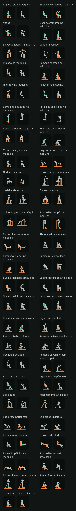

# Fase 4: figuras do lote das máquinas (Task L)

Data: 2026-10-31. Plano: [fase 4A, Task L](../plans/2026-10-29-phase4a-library.md#task-l-condicional-só-com-o-g1-aprovado-um-lote-de-figuras). Spec: [D3, D4, D5 e D21](../specs/2026-10-29-phase4-library-routines-design.md#mídia-do-exercício). Piloto aprovado no G1, com o equipamento em cobre: [folha do piloto](2026-10-30-phase4a-folha-piloto.md). Lotes anteriores: [barra](2026-10-31-phase4-figuras-barra.md), [halter](2026-10-31-phase4-figuras-halter.md), [polia](2026-10-31-phase4-figuras-polia.md) e [peso corporal](2026-10-31-phase4-figuras-peso-corporal.md).

Este é o quinto lote depois do piloto. Ele desenha as máquinas do catálogo, de placas (`selectorized_*`) e de anilhas (`plate_*`), que ainda não tinham figura: 49 exercícios novos. Com os 3 do piloto (leg press 45°, cadeira extensora e mesa flexora), a família das máquinas fica com 52 figuras. O 53º, a rotação de tronco na máquina, fica sem figura de propósito e continua com o ícone do equipamento (ver A1). O Smith é um lote à parte, como pede a D4.

## O que você está vendo

Cada exercício tem dois quadros, como nos lotes anteriores:

- **A** (à esquerda): onde a repetição começa.
- **B** (à direita): onde ela vira. É o quadro que aparece parado na lista.

As figuras são as mesmas do piloto: o mesmo esqueleto, o mesmo traço, o equipamento em cobre, o lado de lá do corpo mais apagado e o músculo principal em verde. Nada mudou no renderizador nem nos tokens. O lote é só dado (as poses) e teste.

Há quatro imagens, capturadas no emulador (Pixel 8, Android 15) pelo `PilotSheetCaptureTest` com `-e lot machine`, que desenha só as figuras novas da família:

| | Tema claro | Tema escuro |
| --- | --- | --- |
| **64 dp** (a miniatura da lista) | [machine-light-64.png](2026-10-31-phase4-figuras-maquinas/machine-light-64.png) | [machine-dark-64.png](2026-10-31-phase4-figuras-maquinas/machine-dark-64.png) |
| **360 dp** (o detalhe num celular de 412 dp) | [machine-light-detail.png](2026-10-31-phase4-figuras-maquinas/machine-light-detail.png) | [machine-dark-detail.png](2026-10-31-phase4-figuras-maquinas/machine-dark-detail.png) |

As folhas do detalhe são compridas (98 quadros cada). Abra pelos links da tabela.

Como as imagens foram feitas: as miniaturas usam a densidade do emulador (2,625×); a folha do detalhe usa 1,35×, para caberem dois quadros de 360 dp lado a lado, como nas folhas anteriores. Os PNGs estão sem compressão de paleta (não há `pngquant` nesta máquina).

## Os 49 exercícios

| # | Nome no app | `stableId` |
| --- | --- | --- |
| 1 | Supino reto na máquina | `selectorized_chest_press` |
| 2 | Supino inclinado na máquina | `selectorized_chest_press_incline` |
| 3 | Voador | `selectorized_pec_fly` |
| 4 | Desenvolvimento na máquina | `selectorized_shoulder_press` |
| 5 | Elevação lateral na máquina | `selectorized_lateral_raise` |
| 6 | Voador invertido | `selectorized_reverse_fly` |
| 7 | Puxada na máquina | `selectorized_lat_pulldown` |
| 8 | Remada sentada na máquina | `selectorized_seated_row` |
| 9 | High row na máquina | `selectorized_high_row` |
| 10 | Pullover na máquina | `selectorized_pullover` |
| 11 | Barra fixa assistida na máquina | `selectorized_assisted_pull_up` |
| 12 | Paralelas assistidas na máquina | `selectorized_assisted_dip` |
| 13 | Rosca bíceps na máquina | `selectorized_biceps_curl` |
| 14 | Extensão de tríceps na máquina | `selectorized_triceps_extension` |
| 15 | Tríceps mergulho na máquina | `selectorized_triceps_press` |
| 16 | Leg press horizontal na máquina | `selectorized_leg_press` |
| 17 | Cadeira flexora | `selectorized_leg_curl_seated` |
| 18 | Flexora em pé na máquina | `selectorized_leg_curl_standing` |
| 19 | Cadeira abdutora | `selectorized_hip_abduction` |
| 20 | Cadeira adutora | `selectorized_hip_adduction` |
| 21 | Coice de glúteo na máquina | `selectorized_glute_kickback` |
| 22 | Panturrilha em pé na máquina | `selectorized_calf_raise_standing` |
| 23 | Panturrilha sentado na máquina | `selectorized_calf_raise_seated` |
| 24 | Abdominal na máquina | `selectorized_abdominal_crunch` |
| 25 | Extensão lombar na máquina | `selectorized_back_extension` |
| 26 | Supino reto articulado | `plate_chest_press` |
| 27 | Supino inclinado articulado | `plate_chest_press_incline` |
| 28 | Supino declinado articulado | `plate_chest_press_decline` |
| 29 | Supino unilateral articulado | `plate_chest_press_one_arm` |
| 30 | Desenvolvimento articulado | `plate_shoulder_press` |
| 31 | Remada apoiada articulada | `plate_row_chest_supported` |
| 32 | High row articulado | `plate_row_high` |
| 33 | Remada baixa articulada | `plate_row_low` |
| 34 | Remada unilateral articulada | `plate_row_one_arm` |
| 35 | Puxada articulada | `plate_lat_pulldown` |
| 36 | Remada cavalinho com apoio no peito | `plate_t_bar_row_supported` |
| 37 | Agachamento hack | `plate_hack_squat` |
| 38 | Agachamento pêndulo | `plate_pendulum_squat` |
| 39 | Belt squat | `plate_belt_squat` |
| 40 | Agachamento articulado | `plate_leverage_squat` |
| 41 | Leg press horizontal | `plate_leg_press_horizontal` |
| 42 | Leg press unilateral | `plate_leg_press_one_leg` |
| 43 | Extensora articulada | `plate_leg_extension` |
| 44 | Flexora articulada | `plate_leg_curl` |
| 45 | Elevação pélvica na máquina | `plate_hip_thrust` |
| 46 | Panturrilha sentado articulada | `plate_calf_raise_seated` |
| 47 | Panturrilha em pé articulada | `plate_calf_raise_standing` |
| 48 | Rosca Scott articulada | `plate_biceps_curl` |
| 49 | Tríceps mergulho articulado | `plate_triceps_dip` |

## Escolhas de desenho

Com as primitivas que o piloto já tinha, sem nenhuma nova:

- **A máquina é desenhada pelos pontos de contato**, como a cadeira extensora e o leg press do piloto: o assento (`seat`, com um pé só), o encosto ou o apoio do peito (um banco em pé, com o pé até o chão, ou um assento inclinado), os rolos (`pad`, que seguem o membro que empurram), a plataforma dos pés e o pegador, uma linha curta atravessada na mão. Não há pilha de placas nem braço de alavanca: a pilha encheria a miniatura, e um braço que vai de um pivô à mão se desenha igual a um cabo de polia.
- **Três exceções têm alavanca ou corrente**, porque sem ela a máquina não aparece: a remada cavalinho, o agachamento articulado e a panturrilha em pé articulada têm a alavanca como o landmine do lote da barra (a primitiva do cabo, de um pivô no chão até as mãos ou os ombros); o belt squat tem a corrente do cinto, do quadril até a alavanca sob a plataforma. A panturrilha em pé de placas tem a coluna da máquina (uma caixa estreita e alta) com o apoio dos ombros encostado nela.
- **O assento fica onde a dica põe o corpo:** o pegador na altura do meio do peito nos supinos, do alto do peito no inclinado e da parte de baixo no declinado; na altura do ombro no desenvolvimento, no voador e no voador invertido; o joelho no pivô na extensora, nas flexoras, na rosca e no tríceps; o rolo da coxa sobre os joelhos nas puxadas, no high row articulado e na cadeira flexora; o rolo da perna logo acima do calcanhar nas flexoras e na frente da canela na extensora.
- **O apoio do peito fica à frente do tronco** no voador invertido, na remada sentada, no high row de placas e na remada baixa articulada (um banco em pé), e inclinado sob o peito na remada apoiada, na unilateral e na remada cavalinho (um assento inclinado).
- **Hack e pêndulo:** o encosto anda com a pessoa num trilho. O trilho é um banco inclinado fixo, paralelo às costas, e o quadril desce ao longo dele, com os pés parados na plataforma; o tronco mantém o ângulo nos dois quadros. O pêndulo tem o tronco mais em pé e desce mais fundo.
- **Vista de frente** (a exceção da Task 8): a elevação lateral na máquina, a cadeira abdutora e a cadeira adutora, que acontecem no plano frontal. O assento é uma caixa entre as pernas, como a elevação lateral sentado do lote do halter, e os rolos ficam do lado de fora (abdutora) ou de dentro (adutora) dos joelhos.
- **Ajoelhado no apoio:** a barra fixa e as paralelas assistidas repetem as poses do lote do peso corporal, com os joelhos dobrados sobre o rolo de apoio, que sobe com o corpo.
- **De pé numa perna:** na flexora em pé, o pé de apoio fica num degrau e os antebraços na coluna da máquina; no coice de glúteo, os antebraços ficam no apoio da máquina (uma caixa), o rolo atrás do joelho da perna que trabalha, que termina em linha com o tronco.
- **Iguais de propósito:** as versões de placas e de anilhas de um mesmo exercício (supinos, desenvolvimento, puxada, rosca, mergulho, panturrilha em pé, leg press, extensora) têm o mesmo desenho, com diferenças pequenas (o encosto um pouco mais inclinado, o caminho do braço convergindo); de lado, a máquina por dentro não aparece.

## A crítica e o que mudou

Fiz a crítica de tela nas quatro folhas com as três perguntas do piloto: o movimento se entende a 64 dp? O destaque se vê? O A difere do B? Antes da folha do emulador, as poses passaram pela prévia local dos lotes anteriores (o mesmo cálculo de cinemática, a mesma ordem de desenho e as mesmas checagens de margem e de chão, em SVG), onde saíram as primeiras correções:

- **Pegador:** com 7 unidades, sumia dentro da ponta do antebraço; passou a 10.
- **Assento:** o assento com encosto sobrava para trás do encosto; agora começa nele.
- **Supinos, quadro A:** com o cotovelo na altura do ombro, o antebraço cruzava o rosto; o cotovelo desceu (para trás e para baixo) e a mão fica no peito.
- **Desenvolvimento, quadro A:** a mão ficava dentro do anel da cabeça; o cotovelo foi um pouco para a frente.
- **Puxada e high row, quadro B:** o antebraço sumia atrás da cabeça; a mão termina à frente, na altura do ombro.
- **Extensão de tríceps:** o primeiro desenho usava o apoio inclinado da rosca, e o A do tríceps ficava igual ao B da rosca; o braço agora fica quase na horizontal sobre o apoio, como na máquina, com a mão perto da testa no A.
- **Flexora em pé e coice de glúteo, quadro A:** o pé da perna que trabalha afundava no chão. Na flexora, o pé de apoio subiu para um degrau; no coice, a coxa vai mais à frente e o pé fica no ar.
- **Abdutora e adutora:** com os joelhos juntos, as coxas desciam retas e a figura lia como em pé atrás de uma caixa. O quadro "fechado" ficou com os joelhos um pouco abertos (a coxa não encurta de frente), e os braços seguram os pegadores ao lado do assento em vez de cruzar o tronco.
- **Hack, pêndulo e agachamento articulado:** os braços dobrados no peito escondiam o apoio dos ombros; as mãos descem para os pegadores, e o apoio fica à frente do ombro. O agachamento articulado, sem nada além do apoio, lia como um agachamento livre; ganhou a alavanca.
- **Remada cavalinho:** sem a alavanca, lia como uma remada curvada; ganhou a alavanca do pivô no chão até as mãos, e o apoio do peito saiu de baixo do tronco.
- **Margem:** o leg press horizontal e a panturrilha sentado na máquina andaram 4 unidades para a direita, para a linha do chão não sair do quadro.

### Achados da folha: corrigidos

Na primeira folha do emulador:

- **Panturrilha em pé, nas duas máquinas:** a 64 dp, o apoio dos ombros atrás da cabeça lia como um coque, e a figura parecia em pé num degrau sem máquina. A de placas ganhou a coluna da máquina, com o apoio encostado nela; a de anilhas, a alavanca do pivô no chão até os ombros, como o agachamento articulado.
- **Tríceps mergulho, nas duas máquinas, quadro B:** com o braço esticado reto para baixo, ele sumia dentro do tronco, e o quadro da lista mostrava só uma pessoa sentada. O braço termina um pouco à frente do corpo, com o cotovelo ainda junto, e se vê da junta do ombro até o pegador sobre a coxa.

A folha foi capturada de novo depois disso.

### Achados altos

- **A1. Rotação de tronco na máquina: sem figura.** O tronco gira em torno do próprio eixo, sentado, com as pernas presas. De lado, nada se mexe; de frente, o ombro que vai para a frente e o que vai para trás estão na direção de quem olha (o esqueleto não encurta osso). Os dois quadros seriam a mesma pessoa sentada, e o `framesDiffer` só passaria com um movimento inventado. Pela regra do Pallof press (A2 do lote da polia), uma figura que engana é pior que o ícone do equipamento: `selectorized_torso_rotation` entrou em `ExerciseFigures.NO_FIGURE`, com o motivo no KDoc. O `machineFamilyIsComplete` pula a lista, e o `noFigureIdsAreCatalogExercisesWithoutAFigure` já confere que ela não envelhece. **Decisão para o controlador confirmar**, como foi a do Pallof.

Nenhum exercício do lote é um encolhimento (o A1 dos lotes da barra e do halter não aparece). Nada pediu mudança de esqueleto ou de renderizador.

### Achados médios: ficam, com o motivo

- **M1. Voador e voador invertido:** como os crucifixos e os crossovers dos lotes anteriores, os braços que abrem para o lado são desenhados varrendo para trás. O B do voador (braços à frente) fica parecido com o B do supino na máquina; o A (braços abertos para trás, contra o encosto) é que separa os dois.
- **M2. Supinos, quadro A, e remadas, quadro B:** com a mão no peito, o braço dobrado fica sobre o tronco e o pegador some atrás dele. A 64 dp, o A dos supinos é um "<" no peito e o B das remadas, um "V" com o cotovelo atrás das costas. Lê como "mão no peito", não como "empurrar" ou "puxar"; o par A e B, no detalhe, mostra o caminho.
- **M3. Elevação lateral na máquina:** de frente, o antebraço que aponta para a frente (cotovelo dobrado, como a máquina pede) não se desenha; ele aparece caído para baixo no B, o que mostra o cotovelo dobrado, mas não para onde a mão aponta.
- **M4. Abdutora e adutora:** de frente, a coxa que aponta para quem olha não encurta, então os joelhos "juntos" ficam um pouco abertos, e a figura lê como sentada com as pernas afastadas. A diferença entre os quadros (mais aberto, menos aberto) e os rolos de fora ou de dentro do joelho contam o exercício; a adutora termina com os rolos se encontrando, como a dica pede.
- **M5. Panturrilha sentado na máquina** (o "calf press"): as pernas quase esticadas contra a plataforma ficam parecidas com o fim do leg press; só os pés mudam entre os quadros, e a 64 dp a mudança é pequena. O destaque na panturrilha ajuda.
- **M6. Pullover na máquina:** os apoios dos cotovelos ficaram de fora (de lado, eles se sobrepõem à cabeça no quadro A); o arco dos braços, de cima da cabeça até a barriga, conta o exercício.
- **M7. Flexora em pé, quadro A:** a perna que trabalha, esticada, chega perto do degrau, e o A lê como "em pé nas duas pernas"; o B, que é o da lista, mostra a flexão.
- **M8. Hack e pêndulo:** o pêndulo desce num arco, não num trilho reto; aqui os dois descem ao longo do encosto, e o que os separa é o tronco mais em pé e a descida mais funda do pêndulo.

### Achados baixos

- As versões de placas e de anilhas do mesmo exercício são quase iguais (ver "Iguais de propósito"); muda o nome e, às vezes, o encosto.
- O leg press horizontal de placas e o de anilhas diferem pela inclinação do encosto e pela profundidade do A.
- A puxada e o high row articulado diferem pelo ângulo dos braços no A (para cima na puxada, para cima e à frente no high row).
- A extensora articulada repete a cadeira extensora do piloto, com o encosto um pouco inclinado.
- A barra fixa assistida e as paralelas assistidas têm o rolo de apoio solto no ar (a máquina por baixo não é desenhada).
- Tema escuro: o lado de lá (a perna de apoio da flexora em pé e do coice, o braço parado do supino e da remada unilaterais, a perna dobrada do leg press unilateral) fica apagado, como no piloto, com contraste já testado.

Nenhum achado é de cor, toque ou texto: a folha não é uma tela do app.

### Revisão de conteúdo (D21a): pose contra as dicas e a anatomia

Conferi cada pose com as quatro dicas do exercício (`files/exercise_cues/en.json`) e com a `ExerciseAnatomyTable`. O destaque sai da anatomia, pela tabela da decisão 9: frente do tronco nos supinos, no voador e no abdominal; ombro no desenvolvimento, na elevação lateral e no voador invertido; trás do tronco nas puxadas, nas remadas, no pullover, na barra assistida e na extensão lombar; trás do braço no tríceps, no mergulho e nas paralelas assistidas; frente do braço nas roscas; frente da coxa nos leg press, nos agachamentos, na extensora e na adutora (adutores); trás da coxa nas flexoras; quadril na abdutora, no coice e na elevação pélvica; trás da canela nas panturrilhas.

Corrigidos:

- **C1. Extensão de tríceps:** a dica põe o cotovelo no pivô com o braço no apoio; o braço ficou quase na horizontal sobre o apoio, e o B estende o cotovelo por completo, na linha do braço.
- **C2. Tríceps mergulho:** a dica pede o cotovelo dobrado a cerca de 90° no início, junto ao corpo, e o braço esticado no fim; o A tem os 90° (braço e antebraço a 90° um do outro), e o B estica o braço sem afastar o cotovelo.
- **C3. Coice de glúteo:** a dica pede parar quando o quadril estende por completo; o B para com a coxa exatamente na linha do tronco (235° com o tronco a 55°).
- **C4. Panturrilha em pé:** a dica pede os ombros sob o apoio; o apoio agora está preso à máquina (coluna ou alavanca), e os joelhos ficam esticados nos dois quadros.

Conferidos sem mudança, lado a lado com a dica: os supinos têm as costas no encosto e o pegador na altura que a dica pede, e terminam com os braços esticados (para cima e à frente no inclinado, à frente e para baixo no declinado); o unilateral segura o outro pegador com o braço de lá parado; o desenvolvimento começa na altura do ombro e termina com os braços esticados; o voador tem o cotovelo levemente dobrado e fixo, e o invertido apoia o peito no apoio; a elevação lateral tem os rolos do lado de fora do braço e para na altura do ombro; as puxadas prendem as coxas sob o rolo e levam as mãos à altura do ombro; as remadas mantêm o peito no apoio e levam o cotovelo além do tronco (à cintura na remada baixa, com os pés apoiados); o high row articulado prende as coxas e começa com os braços para cima; o pullover vai de cima da cabeça até a barriga; a barra assistida termina com o queixo acima da barra; as paralelas assistidas mantêm o tronco em pé e descem até o braço nivelar; as roscas têm a axila na borda do apoio e o cotovelo no pivô, e começam com o braço quase esticado; os leg press começam com o joelho a cerca de 90° (mais fundo no horizontal de anilhas) e terminam sem travar o joelho, com as costas e o quadril no encosto; o unilateral apoia o outro pé dobrado; a cadeira flexora tem o rolo da coxa sobre os joelhos e o da perna acima do calcanhar, e leva o calcanhar para baixo e para trás; a flexora em pé mantém a coxa parada contra o rolo; a flexora articulada mantém o quadril no apoio; a abdutora e a adutora seguram os pegadores e mantêm o quadril no assento; a panturrilha sentado na máquina mantém o joelho parado e só mexe o tornozelo, e a articulada tem o rolo sobre as coxas, logo acima dos joelhos, e as pontas dos pés na borda do degrau; o abdominal tem os apoios no alto do peito e leva as costelas ao quadril; a extensão lombar tem o apoio nas escápulas, os pés no chão, e para no tronco em pé, sem passar; a remada cavalinho fica de pé nas placas com o peito no apoio; o hack e o pêndulo têm os ombros sob os apoios e as costas no encosto; o belt squat tem o cinto no quadril, as mãos só no pegador e o tronco em pé; o agachamento articulado tem os pés um pouco à frente; a elevação pélvica tem o alto das costas no encosto, o rolo no quadril e para com ombros, quadril e joelhos alinhados e a canela vertical.

Fica sem figura, com o motivo, a rotação de tronco (A1). Ficam com o motivo os médios M1 a M8, limites do esqueleto ou da vista de lado (braço e coxa sem encurtamento de perspectiva, mão dentro do tronco) ou da máquina desenhada pelos pontos de contato.

## Tamanho

APK debug (`./gradlew :app:clean :app:assembleDebug`, `tools/check-apk-budget.ps1`). Para separar o lote, montei o APK duas vezes nesta branch: uma com o `MachineFigures.kt` e o `ExerciseFigures.kt` da base (`b855449`, o lote do peso corporal) e outra com os deste lote.

- Base (lote do peso corporal): 24.436.324 bytes, crescimento de 783.981 sobre a base do orçamento, 264.595 bytes livres no orçamento de 1 MiB da fase 4 pelo script.
- Este lote: **24.436.324 bytes, o mesmo tamanho. Delta do APK: 0 bytes.** O APK debug cresce em saltos de alinhamento, e o lote coube na folga do empacotador, como o da polia. Medido nos `.dex` de dentro do APK: +10.577 bytes comprimidos (+40.720 sem compressão) para 49 exercícios (98 poses), cerca de 108 bytes comprimidos por pose, um pouco mais que nos lotes anteriores porque as máquinas têm mais peças por quadro.
- Pelo script, continuam **264.595 bytes** livres. Na conta conservadora dos lotes anteriores (o crescimento da base mais o dex comprimido que coube na folga: 784.916 do lote do peso corporal + 10.577 deste), ficam **253.083 bytes**.
- O maior método da tabela deste lote (`MachineFigures.<clinit>`, 52 figuras) tem 10.244 unidades de código no dex (20.488 bytes), abaixo dos 32 KB da regra da Task 8. A tabela continua na DSL, com 52 figuras, abaixo do teto de 60 do `noFamilyTableIsTooLarge`.

Os lotes que faltam (37 exercícios de kettlebell e Smith, menos os que entrarem em `NO_FIGURE`) devem custar perto de 8 KB de dex comprimido pela mesma conta.

## O que não foi provado

- **As figuras num iPhone.** Os testes de iOS rodam só no CI.
- **A leitura por quem treina.** Só o agente que desenhou olhou as figuras, como no piloto e nos lotes anteriores.
- **Celular físico.** Só o emulador.
- **Referências.** Nenhuma imagem de referência foi aberta ou decalcada. As poses e as máquinas vêm de conhecimento geral de execução e das dicas do próprio app, e foram conferidas só nas capturas do nosso renderizador. Não há nenhum asset gerado por IA.
