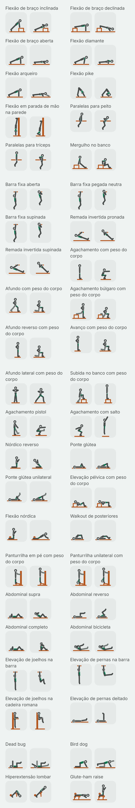
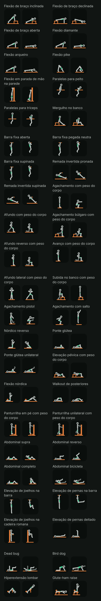

# Fase 4: figuras do lote do peso corporal (Task L)

Data: 2026-10-31. Plano: [fase 4A, Task L](../plans/2026-10-29-phase4a-library.md#task-l-condicional-só-com-o-g1-aprovado-um-lote-de-figuras). Spec: [D3, D4, D5 e D21](../specs/2026-10-29-phase4-library-routines-design.md#mídia-do-exercício). Piloto aprovado no G1, com o equipamento em cobre: [folha do piloto](2026-10-30-phase4a-folha-piloto.md). Lotes anteriores: [barra](2026-10-31-phase4-figuras-barra.md), [halter](2026-10-31-phase4-figuras-halter.md) e [polia](2026-10-31-phase4-figuras-polia.md).

Este é o quarto lote depois do piloto. Ele desenha os exercícios de peso corporal do catálogo que ainda não tinham figura, inclusive os que usam uma barra, as paralelas, um banco, uma caixa ou a parede como apoio: 44 exercícios novos. Com os 2 do piloto (flexão de braço e barra fixa pronada), a família fica completa, com 46 figuras. Nenhum exercício do lote entrou em `NO_FIGURE`.

## O que você está vendo

Cada exercício tem dois quadros, como nos lotes anteriores:

- **A** (à esquerda): onde a repetição começa.
- **B** (à direita): onde ela vira. É o quadro que aparece parado na lista.

As figuras são as mesmas do piloto: o mesmo esqueleto, o mesmo traço, o equipamento em cobre, o lado de lá do corpo mais apagado e o músculo principal em verde. Nada mudou no renderizador nem nos tokens. O lote é só dado (as poses) e teste.

Há quatro imagens, capturadas no emulador (Pixel 8, Android 15) pelo `PilotSheetCaptureTest` com `-e lot bodyweight`, que desenha só as figuras novas da família:

| | Tema claro | Tema escuro |
| --- | --- | --- |
| **64 dp** (a miniatura da lista) | [bodyweight-light-64.png](2026-10-31-phase4-figuras-peso-corporal/bodyweight-light-64.png) | [bodyweight-dark-64.png](2026-10-31-phase4-figuras-peso-corporal/bodyweight-dark-64.png) |
| **360 dp** (o detalhe num celular de 412 dp) | [bodyweight-light-detail.png](2026-10-31-phase4-figuras-peso-corporal/bodyweight-light-detail.png) | [bodyweight-dark-detail.png](2026-10-31-phase4-figuras-peso-corporal/bodyweight-dark-detail.png) |

As folhas do detalhe são compridas (88 quadros cada). Abra pelos links da tabela.

Como as imagens foram feitas: as miniaturas usam a densidade do emulador (2,625×); a folha do detalhe usa 1,35×, para caberem dois quadros de 360 dp lado a lado, como nas folhas anteriores. Os PNGs estão sem compressão de paleta (não há `pngquant` nesta máquina).

## Os 44 exercícios

| # | Nome no app | `stableId` |
| --- | --- | --- |
| 1 | Flexão de braço inclinada | `bodyweight_push_up_incline` |
| 2 | Flexão de braço declinada | `bodyweight_push_up_decline` |
| 3 | Flexão de braço aberta | `bodyweight_push_up_wide` |
| 4 | Flexão diamante | `bodyweight_push_up_diamond` |
| 5 | Flexão arqueiro | `bodyweight_push_up_archer` |
| 6 | Flexão pike | `bodyweight_push_up_pike` |
| 7 | Flexão em parada de mão na parede | `bodyweight_push_up_handstand` |
| 8 | Paralelas para peito | `bodyweight_dip_chest` |
| 9 | Paralelas para tríceps | `bodyweight_dip_triceps` |
| 10 | Mergulho no banco | `bodyweight_bench_dip` |
| 11 | Barra fixa aberta | `bodyweight_pull_up_wide` |
| 12 | Barra fixa pegada neutra | `bodyweight_pull_up_neutral` |
| 13 | Barra fixa supinada | `bodyweight_chin_up` |
| 14 | Remada invertida pronada | `bodyweight_row_inverted` |
| 15 | Remada invertida supinada | `bodyweight_row_inverted_underhand` |
| 16 | Agachamento com peso do corpo | `bodyweight_squat` |
| 17 | Afundo com peso do corpo | `bodyweight_split_squat` |
| 18 | Agachamento búlgaro com peso do corpo | `bodyweight_bulgarian_split_squat` |
| 19 | Afundo reverso com peso do corpo | `bodyweight_lunge_reverse` |
| 20 | Avanço com peso do corpo | `bodyweight_lunge_forward` |
| 21 | Afundo lateral com peso do corpo | `bodyweight_lunge_lateral` |
| 22 | Subida no banco com peso do corpo | `bodyweight_step_up` |
| 23 | Agachamento pistol | `bodyweight_pistol_squat` |
| 24 | Agachamento com salto | `bodyweight_squat_jump` |
| 25 | Nórdico reverso | `bodyweight_reverse_nordic` |
| 26 | Ponte glútea | `bodyweight_glute_bridge` |
| 27 | Ponte glútea unilateral | `bodyweight_glute_bridge_one_leg` |
| 28 | Elevação pélvica com peso do corpo | `bodyweight_hip_thrust` |
| 29 | Flexão nórdica | `bodyweight_nordic_curl` |
| 30 | Walkout de posteriores | `bodyweight_hamstring_walkout` |
| 31 | Panturrilha em pé com peso do corpo | `bodyweight_calf_raise` |
| 32 | Panturrilha unilateral com peso do corpo | `bodyweight_calf_raise_one_leg` |
| 33 | Abdominal supra | `bodyweight_crunch` |
| 34 | Abdominal reverso | `bodyweight_reverse_crunch` |
| 35 | Abdominal completo | `bodyweight_sit_up` |
| 36 | Abdominal bicicleta | `bodyweight_bicycle_crunch` |
| 37 | Elevação de joelhos na barra | `bodyweight_hanging_knee_raise` |
| 38 | Elevação de pernas na barra | `bodyweight_hanging_leg_raise` |
| 39 | Elevação de joelhos na cadeira romana | `bodyweight_captains_chair_knee_raise` |
| 40 | Elevação de pernas deitado | `bodyweight_lying_leg_raise` |
| 41 | Dead bug | `bodyweight_dead_bug` |
| 42 | Bird dog | `bodyweight_bird_dog` |
| 43 | Hiperextensão lombar | `bodyweight_back_extension` |
| 44 | Glute-ham raise | `bodyweight_glute_ham_raise` |

## Escolhas de desenho

Com as primitivas que o piloto já tinha, sem nenhuma nova:

- **Barras fixas:** a barra da barra fixa e a da remada invertida correm de lado a lado do corpo, então de lado seriam um ponto; ficam como no piloto, uma linha curta nas mãos. As paralelas correm ao longo do corpo, então são uma linha comprida na altura das mãos, por trás da figura.
- **Deitado de costas, a cabeça fica à esquerda**, porque a frente da figura (o lado do destaque de peito e abdômen) tem de olhar para cima; de bruços (flexões, bird dog, glute-ham), a cabeça fica à direita, como na flexão do piloto. De cabeça para baixo (parada de mão), a frente da figura fica à esquerda e a parede, atrás dos calcanhares, à direita.
- **Parede, poste e encosto** são caixas estreitas e altas, como o poste da panturrilha do lote do halter: a parede da parada de mão, o poste das duas panturrilhas e o encosto da cadeira romana (com o apoio dos antebraços como uma barra curta).
- **Banco e caixa:** o banco das flexões inclinada e declinada, do mergulho, do búlgaro e da elevação pélvica é o banco das famílias anteriores (assento a 74, pernas até o chão); a subida usa a caixa da altura do joelho do lote do halter; o degrau das panturrilhas é a caixa baixa.
- **Máquinas sem chão:** a hiperextensão a 45° é o apoio das coxas (um assento inclinado sobre a haste), o rolo atrás dos tornozelos e a plataforma dos pés, sem linha de chão (como a cadeira extensora do piloto); o glute-ham é um banco sob as canelas, o rolo sob os joelhos, o rolo sobre os tornozelos e a placa dos pés.
- **Mãos na cintura** nos afundos, no búlgaro e na elevação pélvica: sem halter, o braço pendurado some dentro do tronco; com a mão na cintura, o cotovelo para trás dá forma à figura em pé.
- **Corpo em linha:** nas flexões, nas remadas invertidas, no nórdico e no nórdico reverso, o corpo é um segmento só dos tornozelos (ou dos joelhos) aos ombros, e as poses foram calculadas pela cinemática, com os pés e as mãos parados entre os quadros. Na ponte, o fim alinha ombros, quadril e joelhos, como pede a dica.
- **Vista de frente** (a exceção da Task 8): só o afundo lateral, como o do lote do halter, com as mãos juntas na frente do peito.
- **Margem:** o salto agachado usa um chão um pouco mais baixo (y 89), para os braços levantados caberem no quadro; no fim do salto os pés ficam acima da linha do chão, que continua desenhada.

## A crítica e o que mudou

Fiz a crítica de tela nas quatro folhas com as três perguntas do piloto: o movimento se entende a 64 dp? O destaque se vê? O A difere do B? Antes da folha do emulador, as poses passaram pela prévia local dos lotes anteriores (o mesmo cálculo de cinemática, a mesma ordem de desenho e as mesmas checagens de margem e de chão, em SVG), onde saíram as primeiras correções:

- **Flexão arqueiro:** o braço esticado do quadro B passava da margem; a figura andou 8 unidades para trás.
- **Flexão pike:** com o quadril alto, as pernas não alcançavam o chão (o ponto do pé ficava 7 unidades acima dele). O V foi refeito com o tronco a 45° e os pés mais perto das mãos.
- **Remadas invertidas:** a barra estava longe demais dos pés para o peito chegar a ela, e o fim saía com o corpo em pé. A barra foi para a altura do quadril, onde o peito a toca com o corpo a uns 45°, e o cotovelo, que dobrava para cima, passou a ir para trás das costas, na direção do chão.
- **Abdominal reverso, quadro B:** o quadril e depois a cabeça atravessavam o chão; o tronco passou a subir do ombro para o quadril (−114°) e a cabeça fica no chão.
- **Bird dog:** a perna esticada ficou com o lado de cá (forte), o braço esticado com o de lá, e os dois agora seguem a linha do tronco, como pede a dica.
- **Glute-ham e hiperextensão:** saíam do quadro à direita; as figuras andaram e os braços ficaram cruzados no peito.
- **Agachamento com salto, quadro A:** os braços "para trás" ficavam ao longo do tronco inclinado e liam como pendurados; agora vão bem para trás, acima do quadril.

### Achados da folha: corrigidos

Na primeira folha do emulador:

- **Hiperextensão lombar, quadro A:** o tronco pendia quase na vertical (172°) e, com os braços cruzados em "V", virava um nó ilegível sobre as pernas e o apoio. O tronco passou a pender a 142° (o quadril dobra uns 100°) e os braços ficam dobrados rentes ao peito, sem o "V".
- **Ponte glútea e ponte unilateral:** o quadril subia mais que a linha dos ombros aos joelhos (o mesmo desenho da ponte com barra) e começava já fora do chão. Agora o quadro A tem o quadril no chão, e o B alinha ombros, quadril e joelhos, o que a dica pede; a perna livre da unilateral segue a coxa.
- **Walkout de posteriores, quadro B:** o quadril quase encostava no chão e a figura lia como deitada; o quadril ficou mais alto, com as pernas quase esticadas.

A folha foi capturada de novo depois disso.

### Achados altos

Nenhum ficou aberto. Nenhum exercício do lote é um encolhimento (o A1 dos lotes da barra e do halter não aparece), e nenhuma pose precisou sair para `NO_FIGURE`: a flexão arqueiro, a mais perto disso, ficou com um compromisso (M1), porque a assimetria entre os braços, que é o que define o exercício, aparece.

### Achados médios: ficam, com o motivo

- **M1. Flexão arqueiro, quadro B:** o braço de lá fica esticado, mas de lado ele aparece indo para a frente, não para o lado (o esqueleto não encurta osso, o mesmo limite dos crucifixos dos lotes anteriores). Lê como "um braço dobrado, o outro esticado", que é o arqueiro; a mão de lá, porém, parece andar entre os quadros.
- **M2. Braços ao lado do corpo deitado** (ponte, abdominal reverso, elevação de pernas deitado, walkout): de lado, o braço no chão fica na frente do tronco, que também está no chão, e cobre o destaque do abdômen quando o tronco está deitado. Na elevação de pernas deitado, que fica deitada nos dois quadros, o verde do abdômen quase não aparece; a dica pede as mãos ao lado do corpo ou sob o quadril, e as duas ficam iguais de lado, então mantive a dica. O mapa corporal do detalhe mostra o músculo.
- **M3. Abdominal bicicleta:** a rotação do tronco (o ombro em direção ao joelho oposto) não aparece de lado; só a troca das pernas.
- **M4. Abdominais com o tronco de um segmento só** (supra, completo, bicicleta): como no lote da polia (M3 de lá), enrolar a coluna e dobrar o quadril têm o mesmo desenho; a cabeça mais baixa que o tronco ajuda.
- **M5. Paralelas, quadro A:** o braço esticado fica junto do tronco e esconde o destaque do peito (paralelas para peito) e do tríceps (paralelas para tríceps); no quadro B, o da lista, os dois aparecem.

### Achados baixos

- A barra fixa aberta, a neutra e a supinada são variações pequenas da barra fixa do piloto (o tronco mais para trás e o peito mais perto da barra na aberta, o cotovelo à frente na neutra e na supinada); a pegada não aparece de lado.
- A flexão aberta tem o desenho da flexão do piloto; a largura das mãos não aparece de lado. A diamante tem as mãos sob o peito e o cotovelo junto do corpo.
- As duas remadas invertidas diferem pouco (a supinada puxa a barra um pouco mais para baixo no peito).
- As duas panturrilhas diferem pela perna livre dobrada atrás, como no lote do halter.
- Afundo, afundo reverso e avanço têm o mesmo fundo, como nos lotes anteriores; muda onde a figura começa.
- Tema escuro: o lado de lá (o braço no poste das panturrilhas, a perna esticada do pistol, a perna levantada da ponte unilateral, a perna e o braço do dead bug e do bird dog) fica apagado, como no piloto, com contraste já testado.

Nenhum achado é de cor, toque ou texto: a folha não é uma tela do app.

### Revisão de conteúdo (D21a): pose contra as dicas e a anatomia

Conferi cada pose com as quatro dicas do exercício (`files/exercise_cues/en.json`) e com a `ExerciseAnatomyTable`. O destaque sai da anatomia, pela tabela da decisão 9 (por exemplo: frente do tronco nas flexões, nas paralelas para peito e nos abdominais; trás do braço na diamante, nas paralelas para tríceps e no mergulho; ombro na pike e na parada de mão; trás do tronco nas barras, nas remadas, na hiperextensão e no bird dog; frente da coxa nos agachamentos, afundos e no nórdico reverso; quadril nas pontes e na elevação pélvica; trás da coxa no nórdico, no walkout e no glute-ham; trás da canela nas panturrilhas).

Corrigidos:

- **C1. Ponte glútea e unilateral:** a dica pede parar quando ombros, quadril e joelhos se alinham; o quadro B agora para ali (ver acima).
- **C2. Bird dog:** a dica pede o braço e a perna opostos "em linha com o tronco"; os dois seguem a inclinação do tronco, um de cada lado do corpo.
- **C3. Remadas invertidas:** a dica pede uma barra na altura da cintura, o corpo em linha e o peito na barra; a barra foi para a altura do quadril em pé e o fim encosta o peito nela, com o cotovelo atrás das costas.
- **C4. Hiperextensão lombar:** a dica pede subir até o corpo alinhar com as pernas, sem arquear; o quadro B para exatamente na linha das pernas.

Conferidos sem mudança, lado a lado com a dica: a flexão inclinada desce o peito até a borda do banco; a declinada tem os pés no banco e o pescoço em linha; a diamante tem as mãos sob o peito e o cotovelo junto do corpo; a pike começa com o quadril alto, a cabeça entre os braços, e desce o alto da cabeça para perto das mãos; a parada de mão fica de costas para a parede, com os calcanhares nela, e desce a cabeça até perto do chão, um pouco à frente das mãos; as paralelas para peito inclinam o tronco e descem até o ombro ficar um pouco abaixo do cotovelo, e as para tríceps mantêm o tronco em pé e param com o braço nivelado; o mergulho tem as mãos na borda do banco atrás, o quadril perto dele e para com o braço nivelado; o agachamento leva os braços à frente e mantém os calcanhares no chão; o afundo tem o calcanhar de trás levantado e o tronco em pé; o búlgaro apoia o peito do pé de trás no banco e desce até a coxa nivelar; o afundo lateral tem a outra perna esticada e as mãos à frente; a subida usa uma caixa da altura do joelho com o pé inteiro em cima; o pistol tem a perna livre à frente, os braços à frente e o calcanhar de apoio no chão; o salto parte de um meio agachamento com os braços atrás e sobe com os braços para cima; o nórdico reverso mantém o quadril estendido e não senta nos calcanhares; a elevação pélvica apoia o alto das costas no banco e para com o quadril na linha dos joelhos e a canela vertical; o nórdico prende os tornozelos sob um rolo, desce em linha dos joelhos à cabeça e tem as mãos prontas; o walkout parte de uma ponte nos calcanhares e leva os calcanhares para longe com o quadril alto; as panturrilhas apoiam as pontas dos pés num degrau, uma mão num apoio; o supra tira as escápulas do chão com as mãos junto à cabeça; o reverso tem as mãos ao lado do corpo e leva os joelhos ao peito tirando o quadril do chão; o completo sobe até o tronco ficar em pé; a bicicleta tem as escápulas fora do chão, um joelho dentro e a outra perna longa e baixa; as elevações na barra começam penduradas e levam os joelhos ao peito ou as pernas esticadas à altura do quadril, com o quadril enrolado; a cadeira romana apoia os antebraços e as costas no encosto; a elevação deitado sobe as pernas esticadas até apontarem para cima; o dead bug tem os braços para cima e os joelhos a 90° sobre o quadril, e estende o braço e a perna opostos; o glute-ham começa com o corpo nivelado dos joelhos à cabeça, o quadril estendido, e sobe dobrando os joelhos.

Ficam com o motivo: M1 a M5, todos limites do esqueleto ou da vista de lado (braço sem encurtamento de perspectiva, tronco de um segmento só, braço no mesmo plano do tronco deitado).

## Tamanho

APK debug (`./gradlew :app:clean :app:assembleDebug`, `tools/check-apk-budget.ps1`). Para separar o lote, montei o APK duas vezes nesta branch: uma com o `BodyweightFigures.kt` da base (`ff012a2`, o lote da polia com a exclusão do Pallof) e outra com o deste lote.

- Base (lote da polia): 24.419.940 bytes, crescimento de 767.597 sobre a base do orçamento, 280.979 bytes livres no orçamento de 1 MiB da fase 4 pelo script (272.316 na conta conservadora do lote da polia, que somava os 8.663 bytes de dex que ele já ocupava na folga do empacotador).
- Este lote: **24.436.324 bytes, crescimento de 783.981. Delta do APK: +16.384 bytes (16 KiB) para 44 exercícios (88 poses).** O APK cresce em saltos de alinhamento, e este salto paga a folga que o lote da polia tinha usado. Medido nos `.dex` de dentro do APK: +8.656 bytes comprimidos (+32.764 sem compressão), cerca de 100 bytes comprimidos por pose, como na polia.
- Pelo script, ficam **264.595 bytes** livres. Na conta conservadora (o crescimento da base mais o dex comprimido da polia e deste lote: 767.597 + 8.663 + 8.656 = 784.916), ficam **263.660 bytes**; a folga do empacotador hoje cobre só 892 bytes disso.
- O maior método da tabela deste lote (`BodyweightFigures.<clinit>`, 46 figuras) tem 7.554 unidades de código no dex (15.108 bytes), abaixo dos 32 KB da regra da Task 8. A tabela continua na DSL.

Os lotes que faltam (87 exercícios de máquina, kettlebell, Smith e outros, menos os que entrarem em `NO_FIGURE`) devem custar perto de 17 KB de dex comprimido pela mesma conta.

## O que não foi provado

- **As figuras num iPhone.** Os testes de iOS rodam só no CI.
- **A leitura por quem treina.** Só o agente que desenhou olhou as figuras, como no piloto e nos lotes anteriores.
- **Celular físico.** Só o emulador.
- **Referências.** Nenhuma imagem de referência foi aberta ou decalcada. As poses vêm de conhecimento geral de execução e das dicas do próprio app, e foram conferidas só nas capturas do nosso renderizador. Não há nenhum asset gerado por IA.
