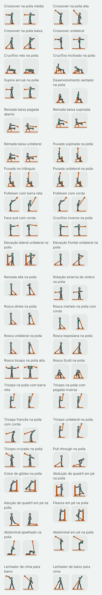
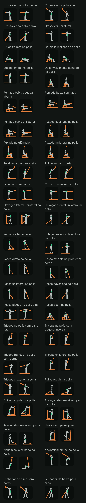

# Fase 4: figuras do lote da polia (Task L)

Data: 2026-10-31. Plano: [fase 4A, Task L](../plans/2026-10-29-phase4a-library.md#task-l-condicional-só-com-o-g1-aprovado-um-lote-de-figuras). Spec: [D3, D4, D5 e D21](../specs/2026-10-29-phase4-library-routines-design.md#mídia-do-exercício). Piloto aprovado no G1, com o equipamento em cobre: [folha do piloto](2026-10-30-phase4a-folha-piloto.md). Lotes anteriores: [barra](2026-10-31-phase4-figuras-barra.md) e [halter](2026-10-31-phase4-figuras-halter.md).

Este é o terceiro lote depois do piloto. Ele desenha os exercícios de polia do catálogo que ainda não tinham figura: 42 exercícios novos. Com os 3 de polia do piloto (puxada aberta, remada baixa no triângulo e tríceps com corda), a família da polia fica com 45 figuras. O 46º, o Pallof press, fica sem figura de propósito e continua com o ícone do equipamento (ver A2).

## O que você está vendo

Cada exercício tem dois quadros, como nos lotes anteriores:

- **A** (à esquerda): onde a repetição começa.
- **B** (à direita): onde ela vira. É o quadro que aparece parado na lista.

As figuras são as mesmas do piloto: o mesmo esqueleto, o mesmo traço, o equipamento em cobre, o lado de lá do corpo mais apagado e o músculo principal em verde. Nada mudou no renderizador nem nos tokens. O lote é só dado (as poses) e teste.

Há quatro imagens, capturadas no emulador (Pixel 8, Android 15) pelo `PilotSheetCaptureTest` com `-e lot cable`, que desenha só as figuras novas da família:

| | Tema claro | Tema escuro |
| --- | --- | --- |
| **64 dp** (a miniatura da lista) | [cable-light-64.png](2026-10-31-phase4-figuras-polia/cable-light-64.png) | [cable-dark-64.png](2026-10-31-phase4-figuras-polia/cable-dark-64.png) |
| **360 dp** (o detalhe num celular de 412 dp) | [cable-light-detail.png](2026-10-31-phase4-figuras-polia/cable-light-detail.png) | [cable-dark-detail.png](2026-10-31-phase4-figuras-polia/cable-dark-detail.png) |

As folhas do detalhe são compridas (84 quadros cada). Abra pelos links da tabela.

Como as imagens foram feitas: as miniaturas usam a densidade do emulador (2,625×); a folha do detalhe usa 1,35×, para caberem dois quadros de 360 dp lado a lado, como nas folhas anteriores. Os PNGs estão sem compressão de paleta (não há `pngquant` nesta máquina).

## Os 42 exercícios

| # | Nome no app | `stableId` |
| --- | --- | --- |
| 1 | Crossover na polia média | `cable_chest_fly_mid` |
| 2 | Crossover na polia alta | `cable_chest_fly_high_low` |
| 3 | Crossover na polia baixa | `cable_chest_fly_low_high` |
| 4 | Crossover unilateral | `cable_chest_fly_one_arm` |
| 5 | Crucifixo reto na polia | `cable_chest_fly_flat_bench` |
| 6 | Crucifixo inclinado na polia | `cable_chest_fly_incline_bench` |
| 7 | Supino em pé na polia | `cable_chest_press` |
| 8 | Desenvolvimento sentado na polia | `cable_shoulder_press` |
| 9 | Remada baixa pegada aberta | `cable_row_wide_overhand` |
| 10 | Remada baixa supinada | `cable_row_underhand` |
| 11 | Remada baixa unilateral | `cable_row_one_arm` |
| 12 | Puxada supinada na polia | `cable_lat_pulldown_underhand` |
| 13 | Puxada no triângulo | `cable_lat_pulldown_neutral` |
| 14 | Puxada unilateral na polia | `cable_lat_pulldown_one_arm` |
| 15 | Pulldown com barra reta | `cable_straight_arm_pulldown_bar` |
| 16 | Pulldown com corda | `cable_straight_arm_pulldown_rope` |
| 17 | Face pull com corda | `cable_face_pull` |
| 18 | Crucifixo inverso na polia | `cable_reverse_fly` |
| 19 | Elevação lateral unilateral na polia | `cable_lateral_raise` |
| 20 | Elevação frontal unilateral na polia | `cable_front_raise` |
| 21 | Remada alta na polia | `cable_upright_row` |
| 22 | Rotação externa de ombro na polia | `cable_external_rotation` |
| 23 | Rosca direta na polia | `cable_curl_straight_bar` |
| 24 | Rosca martelo na polia com corda | `cable_curl_rope` |
| 25 | Rosca unilateral na polia | `cable_curl_one_arm` |
| 26 | Rosca bayesiana na polia | `cable_curl_behind_body` |
| 27 | Rosca bíceps na polia alta | `cable_curl_high` |
| 28 | Rosca Scott na polia | `cable_curl_preacher` |
| 29 | Tríceps na polia com barra reta | `cable_triceps_pushdown_bar` |
| 30 | Tríceps na polia com pegada inversa | `cable_triceps_pushdown_reverse` |
| 31 | Tríceps francês na polia com corda | `cable_triceps_overhead_rope` |
| 32 | Tríceps unilateral na polia | `cable_triceps_pushdown_one_arm` |
| 33 | Tríceps cruzado na polia | `cable_triceps_cross_body` |
| 34 | Pull-through na polia | `cable_pull_through` |
| 35 | Coice de glúteo na polia | `cable_glute_kickback` |
| 36 | Abdução de quadril em pé na polia | `cable_hip_abduction` |
| 37 | Adução de quadril em pé na polia | `cable_hip_adduction` |
| 38 | Flexora em pé na polia | `cable_leg_curl` |
| 39 | Abdominal ajoelhado na polia | `cable_crunch_kneeling` |
| 40 | Abdominal em pé na polia | `cable_crunch_standing` |
| 41 | Lenhador de cima para baixo | `cable_woodchop_high_low` |
| 42 | Lenhador de baixo para cima | `cable_woodchop_low_high` |

## Escolhas de desenho

Com as primitivas que o piloto já tinha, sem nenhuma nova:

- **A polia fica onde o exercício a põe** e não se mexe entre os quadros (o `bothFramesHaveTheSameEquipment` confere): alta (y 8 a 10) nas puxadas, nos tríceps de cima, no crossover alto, no abdominal e no lenhador de cima; na altura do ombro, do peito ou da cabeça no crossover médio, no supino em pé, no crucifixo inverso e no face pull; baixa (y 82 a 86) no crossover baixo, nos crucifixos no banco, no desenvolvimento, nas roscas, nas elevações, na remada alta, no pull-through, no glúteo, na abdução, na adução e na flexora.
- **Polia ao lado do corpo, vista de lado:** as duas polias de um crossover ficam uma de cada lado da pessoa; de lado elas se sobrepõem, e a figura as mostra atrás do corpo, de onde o cabo puxa. Quem fica de frente para a polia (roscas, tríceps, remada alta, flexora, glúteo, face pull, crucifixo inverso) tem a polia à frente; quem fica de costas (elevação frontal, rosca bayesiana, tríceps francês, pull-through, abdominal em pé), atrás.
- **Vista de frente** (a exceção da Task 8, já usada na elevação lateral do piloto e no lote do halter): a elevação lateral, a rotação externa, a rosca na polia alta, o tríceps cruzado, a abdução, a adução e os dois lenhadores. Os oito acontecem no plano frontal, e de lado não se veriam. A rosca na polia alta tem dois cabos, um para cada mão, das duas polias.
- **A coluna da máquina:** quando a dica manda a mão livre segurar a máquina (elevação lateral, glúteo, abdução e flexora), a coluna é uma caixa estreita e alta, com a polia no pé dela, como o poste da panturrilha do lote do halter. Nos outros exercícios a polia fica sozinha, como no piloto.
- **Correia de tornozelo:** no glúteo, na abdução, na adução e na flexora, o cabo vai ao tornozelo da perna que trabalha, não à mão.
- **Margem:** a linha do chão passa 6 unidades além de tudo o que está desenhado, então uma polia baixa não pode ficar a menos de 13,5 unidades da borda; as polias de trás ficam em x 14.

## A crítica e o que mudou

Fiz a crítica de tela nas quatro folhas com as três perguntas do piloto: o movimento se entende a 64 dp? O destaque se vê? O A difere do B? Antes da folha do emulador, as poses passaram pela prévia local dos lotes anteriores (o mesmo cálculo de cinemática, a mesma ordem de desenho e as mesmas checagens de margem e de chão, em SVG), onde saíram as primeiras correções:

- **Margem:** 14 figuras tinham a polia perto demais da borda, e a linha do chão saía do quadro; as polias foram para x 14 e x 86, e o crossover unilateral andou 4 unidades para a direita, para o cabo não sumir no quadro A.
- **Crucifixo reto na polia:** com a polia sob o ombro, o cabo ficava inteiro escondido atrás do banco e do tronco. O banco e a figura andaram 6 unidades, e a polia foi para a ponta da cabeça, de onde o cabo sobe em diagonal até as mãos.
- **Glúteo e flexora, quadro A:** a ponta do pé da perna presa ao cabo afundava no chão; o pé passou a ficar um pouco no ar, como fica de fato, com a correia.
- **Abdominal ajoelhado, quadro B:** os cotovelos atravessavam o chão; o tronco desce até a horizontal (95°), não abaixo, e os cotovelos apontam para o chão sem tocá-lo.
- **Abdominal em pé, quadro B:** o tronco inclinava 48° e lia como uma dobra de quadril; agora inclina 40° e a cabeça desce mais (80°), para o movimento ler como enrolar, não dobrar.

### Achados altos

- **A2. Pallof press: lia como o supino em pé. Resolvido pela exclusão.** O Pallof é um exercício anti-rotação: a polia fica ao lado, e a pessoa empurra a alça para a frente sem deixar o cabo girar o tronco. De lado, o cabo que puxa para o lado vai na direção de quem olha e não aparece; de frente, o empurrão para a frente é que não aparece (o esqueleto não encurta osso). A primeira versão mostrava a pegada no peito e os braços esticados, com o cabo vindo de trás, igual ao supino em pé. **Decisão do controlador (2026-10-31):** uma figura que engana é pior que o ícone do equipamento, que o app já mostra quando um exercício não tem figura. As poses saíram, e `cable_pallof_press` entrou em `ExerciseFigures.NO_FIGURE`, a lista nomeada de exercícios sem figura de propósito, com o motivo no KDoc ("a vista de lado não mostra uma puxada anti-rotação; o ícone do equipamento é mais claro"). O `cableFamilyIsComplete` pula essa lista, o `everyCatalogExerciseHasAFigure` do último lote vai usar a mesma, e o `noFigureIdsAreCatalogExercisesWithoutAFigure` confere que cada id da lista existe no catálogo e não tem figura, para a lista não envelhecer. A folha foi capturada de novo, sem o Pallof.

Nenhum exercício de polia é um encolhimento, então o A1 dos lotes anteriores (sem elevação de ombro) não aparece aqui.

### Achados médios: ficam, com o motivo

- **M1. Crossover médio, alto, baixo e unilateral, e crucifixo inverso:** como os crucifixos do lote do halter (M1 e M2 de lá), os braços que abrem para o lado são desenhados varrendo para trás. Os quatro crossovers leem como "braços de trás para a frente", na altura certa (médio na linha do ombro, alto de cima para o quadril, baixo de baixo para o peito), e o crucifixo inverso faz o caminho de volta, com a polia à frente e o ombro em verde.
- **M2. Crucifixo reto e inclinado na polia:** o quadro B repete o compromisso do crucifixo com halteres (os braços descem em diagonal ao lado do banco). O cabo da polia baixa, a 64 dp, se confunde com as pernas do banco; no detalhe se vê.
- **M3. Abdominal em pé:** o tronco é um segmento só, então o abdominal (enrolar a coluna) e uma dobra de quadril têm o mesmo desenho. A dica diz "não dobre no quadril". A cabeça mais baixa ajuda, mas a 64 dp o B ainda lembra um bom-dia. O abdominal ajoelhado tem o mesmo limite, menos visível, porque as coxas ficam paradas na vertical.
- **M4. Face pull, quadro B:** "mãos ao lado das orelhas" fica, de lado, com a mão sobre a cabeça. O cotovelo alto e para trás aparece; a mão some no anel da cabeça a 64 dp.
- **M5. Rotação externa:** o antebraço gira em torno do braço parado, no plano do chão. De frente, o A mostra o antebraço cruzando a barriga e o B, aberto para o lado; lê como "abrir o antebraço", mas o antebraço apontando para a frente, que é o meio do movimento, não se desenha.
- **M6. Abdução e adução de frente:** o esqueleto tem um só ponto de quadril, então a perna que trabalha sai do centro do corpo, não do lado dela. Lê bem, mas a perna de apoio e a outra começam no mesmo ponto.

### Achados baixos

- A rosca direta, a rosca com corda e a unilateral têm o mesmo desenho; muda o destaque (bíceps; bíceps e antebraço) e, na unilateral, o braço de lá parado ao lado do corpo. A pegada não aparece de lado.
- Os tríceps com barra reta, com pegada inversa e unilateral têm o mesmo desenho do tríceps com corda do piloto, com o tronco um pouco mais em pé; o unilateral tem o braço de lá pendurado.
- As três remadas novas e as três puxadas novas são variações pequenas das do piloto: a remada aberta leva o cotovelo alto e para trás, a supinada puxa ao umbigo, a unilateral apoia a mão livre na coxa; a puxada supinada e a do triângulo têm a pegada mais estreita e o cotovelo junto ao corpo, e a unilateral apoia a mão livre na coxa.
- Os dois pulldowns de braço esticado só diferem no fim (a corda passa um pouco além das coxas).
- Na remada e na puxada unilateral, a mão livre na coxa fica quase escondida atrás da perna e do braço da frente.
- Tema escuro: o lado de lá (a perna de apoio no glúteo e na flexora, a perna de trás nos crossovers) fica apagado, como no piloto, com contraste já testado.

Nenhum achado é de cor, toque ou texto: a folha não é uma tela do app.

### Revisão de conteúdo (D21a): pose contra as dicas e a anatomia

Conferi cada pose com as quatro dicas do exercício (`files/exercise_cues/en.json`) e com a `ExerciseAnatomyTable`. O destaque sai da anatomia, pela tabela da decisão 9 (por exemplo: frente do tronco nos crossovers, no supino em pé, nos abdominais e nos lenhadores; ombro no face pull, no crucifixo inverso, nas elevações, na remada alta e na rotação externa; quadril no pull-through, no glúteo e na abdução; frente da coxa na adução, pelos adutores; trás da coxa na flexora).

Corrigidos:

- **C1. Abdominal em pé:** a dica pede "não dobre no quadril"; o tronco inclina menos e a cabeça desce mais (ver acima e M3).
- **C2. Abdominal ajoelhado:** a dica pede "não sente nos calcanhares"; o quadril fica sobre os joelhos, com as coxas na vertical, nos dois quadros, e só o tronco desce.

Conferidos sem mudança, lado a lado com a dica: a elevação lateral pega a alça com a mão de longe, a outra na máquina, e sobe até a altura do ombro; a rotação externa e o tríceps cruzado usam a mão de longe, com o cabo cruzando à frente do corpo; a abdução prende a correia no tornozelo de longe e a adução, no de perto, que começa puxado para fora e termina cruzando à frente da perna de apoio; o glúteo e a flexora ficam de frente para a máquina, segurando a coluna; a flexora mantém a coxa parada e leva o calcanhar ao glúteo; o pull-through fica de costas para a polia com a corda entre as pernas e leva o quadril para trás com as costas retas; a elevação frontal fica de costas para a polia e para na altura do ombro; a rosca bayesiana começa com o braço um pouco atrás do corpo e mantém o cotovelo atrás; a rosca na polia alta mantém os braços na altura do ombro e leva as mãos às orelhas; a rosca Scott mantém o braço no apoio; o tríceps francês fica de costas para a polia, um pé à frente, com o cotovelo à frente e junto à cabeça; o face pull começa com os braços esticados à frente na altura da cabeça; o pulldown de braço esticado dobra um pouco o quadril e varre da altura da cabeça até as coxas; a puxada unilateral leva o cotovelo para o quadril; a remada unilateral apoia a mão livre na coxa; o desenvolvimento sentado tem o encosto e o antebraço vertical no início; o supino em pé tem um pé à frente e os cotovelos a uns 45°; o crossover alto termina com as mãos à frente do quadril e o baixo, à frente do alto do peito; os lenhadores ficam de lado para a polia, pés mais abertos que os ombros, e cruzam o corpo na diagonal (do alto ao joelho de lá, e do joelho de perto ao alto do ombro de lá).

O Pallof press ficou sem figura (A2): a dica "empurre a alça para a frente e segure sem girar" não tem desenho fiel numa vista de lado nem de frente. Ficam com o motivo os médios M1, M3, M4 e M5, limites do esqueleto ou da vista de lado (braço sem encurtamento de perspectiva, tronco de um segmento só).

## Tamanho

APK debug (`./gradlew :app:clean :app:assembleDebug`, `tools/check-apk-budget.ps1`). Para separar o lote, montei o APK duas vezes nesta branch: uma com o `CableFigures.kt` da base (`27531e0`, o lote do halter) e outra com o deste lote.

- Base (lote do halter): 24.419.940 bytes, crescimento de 767.597 sobre a base do orçamento, 280.979 bytes livres no orçamento de 1 MiB da fase 4.
- Este lote: **24.419.940 bytes, o mesmo tamanho. Delta do APK: 0 bytes.** O APK debug cresce em saltos (o empacotador deixa folga entre as entradas), e o lote coube na folga. Medido nos `.dex` de dentro do APK: +8.663 bytes comprimidos (+33.780 sem compressão) para 43 exercícios (86 poses), cerca de 100 bytes comprimidos por pose. A medida é de antes de o Pallof sair; tirar 2 poses só diminui o número, e não refiz o APK.
- Pelo script, ficam **280.979 bytes** livres. Contando os 8.663 bytes que o lote já ocupa da folga, a conta conservadora é **272.316 bytes** livres: o próximo salto do APK vai aparecer num lote seguinte.
- O maior método da tabela (`CableFigures.<clinit>`, então com 46 figuras; hoje 45) tem 8.681 unidades de código no dex (17.362 bytes), abaixo dos 32 KB da regra da Task 8. A tabela continua na DSL.

Os lotes que faltam (131 exercícios, menos os que entrarem em `NO_FIGURE`) devem custar perto de 26 KB de dex comprimido pela mesma conta.

## O que não foi provado

- **As figuras num iPhone.** Os testes de iOS rodam só no CI.
- **A leitura por quem treina.** Só o agente que desenhou olhou as figuras, como no piloto e nos lotes anteriores.
- **Celular físico.** Só o emulador.
- **Referências.** Nenhuma imagem de referência foi aberta ou decalcada. As poses vêm de conhecimento geral de execução e das dicas do próprio app, e foram conferidas só nas capturas do nosso renderizador. Não há nenhum asset gerado por IA.
